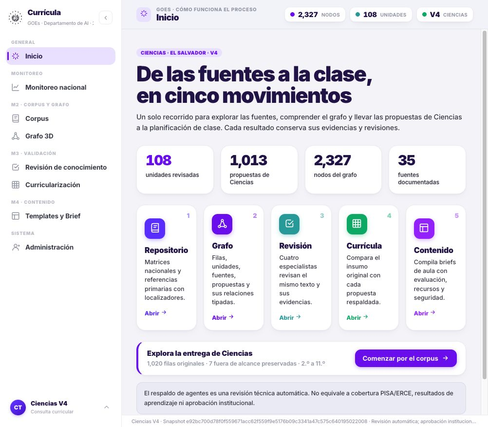
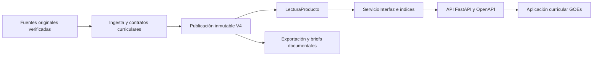

<div align="center">
  
  <h1>GOEs · Science Knowledge Graph</h1>
  <p><strong>Departamento de AI · Gobierno de El Salvador · 2026</strong></p>
  <p>Ingeniería curricular de Ciencias con evidencia verificable, revisión especializada y trazabilidad.</p>

[](docs/badges/medicion.json)
[](docs/badges/medicion.json)
[](docs/badges/medicion.json)
[](pyproject.toml)
[](docs/APLICACION_CIENCIAS.md)
[](https://github.com/carlosjimenez-arch/goes-science-kg/actions/workflows/quality.yml?query=branch%3Afeat%2Fapi)

[Aplicación y API](docs/APLICACION_CIENCIAS.md) · [Arquitectura](docs/ARQUITECTURA.md) · [Operación](docs/OPERACION.md) · [Calidad](docs/CALIDAD.md) · [Documentación](docs/README.md)
</div>

## Propósito

GOEs Science KG organiza la evidencia curricular de **Biología, Física, Química y Ciencias de la
Tierra y del Espacio** para El Salvador. Conserva el currículo original, registra propuestas por
objetivo y permite examinar las fuentes y los dictámenes que sustentan cada resultado.

La aplicación adapta el diseño del HTML curricular aportado: navegación lateral, ocho secciones,
tarjetas, filtros, grafo 3D y modo oscuro. Su CSS principal conserva exactamente los estilos de la
referencia. Los resultados proceden del snapshot verificado del repositorio. **Cuando no existe una
publicación válida, la API responde 503 y la aplicación muestra «No hay datos disponibles».**

El respaldo automático de una propuesta es un resultado técnico. La aprobación institucional, los
resultados de aula y la eficacia de aprendizaje requieren evidencia propia.



Los datos y resultados están separados del código público. El respaldo vigente fija **13.762 archivos**
y **41 SQLite** por generación y SHA. Se restauró en una carpeta vacía, se verificaron 2.295 trazas de
lectores y se reanudaron 32 terminales de clases sin nuevas llamadas a Vertex. [Evidencia de recuperación](docs/VERIFICACION_GCS.md).
[Estado de continuidad](docs/CONTINUIDAD_CIENCIAS_V4.md), [operación](docs/OPERACION.md) y
[alcance de publicación](docs/PUBLICACION.md).

## Producto disponible

La selección local `producto-4`, verificada el **22 de octubre de 2026**, contiene:

| Evidencia publicada | Cantidad |
|---|---:|
| Filas curriculares originales | 1.020 |
| Propuestas de Ciencias | 1.013 |
| Filas fuera de alcance preservadas | 7 |
| Unidades con revisión especializada | 108 |
| Nodos / relaciones | 2.327 / 7.304 |
| Documentos originales y referencias con SHA verificado | 35 |
| Filas originales con alerta científica efectiva | 30 |

Snapshot: `e92bc700d78f0f559671acc62f559f9e5176b09c3341a47c575c640195022008`.
La API conserva esta identidad en las consultas y exportaciones para impedir mezclar generaciones.
Una propuesta corregida no elimina la alerta de su original.

No hay datos conectados de escuelas, territorio, resultados LXP o usuarios institucionales. Esas
vistas declaran su ausencia y no muestran cifras de demostración. El ledger es opcional: una
campaña sin registros no acredita gasto cero; la reserva tampoco equivale a una factura.

## Puesta en marcha

Requisitos: Python 3.11 o superior y `uv`. El archivo `uv.lock` fija las dependencias utilizadas.

```bash
uv sync --frozen --all-extras
# Sólo si el corpus aún no está restaurado y se dispone del acceso institucional:
uv run --frozen gskg datos restaurar --en-repo
uv run --frozen gskg servir --puerto 8010
```

Abrir [la aplicación](http://127.0.0.1:8010/app/) o [OpenAPI](http://127.0.0.1:8010/docs).
La restauración no sobrescribe un corpus existente. El servicio escucha por defecto en
`127.0.0.1`; la consulta, exportación y compilación de briefs no invocan modelos.

El código público no incluye matrices, PDF, snapshots ni SQLite. El corpus privado se recupera
mediante un recibo con generaciones y hashes fijados. [Restauración y límites](docs/DATOS_EXTERNOS.md)
· [Alcance de publicación](docs/PUBLICACION.md).

Sin corpus se puede abrir la aplicación, consultar OpenAPI y comprobar `/health/live`.
`/health/ready` comprueba la disponibilidad real de la publicación y responde 503 si falta.

## Aplicación y API

| Sección | Información real |
|---|---|
| Inicio | Estado y alcance de la publicación seleccionada |
| Monitoreo nacional | Balance curricular por grado; ausencia explícita de métricas escolares |
| Corpus | Fuentes registradas y citadas, versiones, SHA y enlaces disponibles |
| Grafo 3D | Nodos y relaciones tipadas con filtros y alternativa tabular |
| Revisión de conocimiento | Dictámenes registrados por unidad, rol y ronda |
| Curricularización | Comparación original/propuesta, indicadores, didáctica y alertas |
| Templates y Brief | Organización documental de propuestas respaldadas, sin nueva generación |
| Administración | Identidad del snapshot, permisos locales y actividad registrada disponible |

La interfaz consulta `/api/v4/interfaz`. Las rutas principales son:

| Método | Ruta | Resultado |
|---|---|---|
| GET | `/health/live` | Disponibilidad del proceso |
| GET | `/health/ready` | Publicación íntegra y disponible |
| GET | `/api/v4/interfaz/resumen` | Conteos, grados, disciplinas e integraciones |
| GET | `/api/v4/interfaz/filas` | Filtros y paginación con total conservado |
| GET | `/api/v4/interfaz/filas/{id}` | Original, propuesta, evidencia y alertas |
| GET | `/api/v4/interfaz/documentos` | Fuentes verificables de la publicación |
| GET | `/api/v4/interfaz/grafo` | Subgrafo real con recorte explícito |
| GET | `/api/v4/interfaz/nodos/{id}` | Nodo y relaciones; admite IDs con `/` |
| POST | `/api/v4/interfaz/briefs` | Briefs documentales de 1–20 objetivos |
| GET | `/api/v4/interfaz/exportaciones/matriz.xlsx` | Matriz completa original/propuesta |

Los filtros inválidos reciben 422; una identidad ajena recibe 404; una publicación incompatible con
una función recibe 409; la ausencia o alteración de evidencia produce 503. El grafo histórico conserva
sus rutas `/api/*` y su propia procedencia. [Contrato completo](specs/17_aplicacion_curricular.md).

## Arquitectura

La biblioteca docente está disponible en `/api/v4/materiales`: **1.013 paquetes V4 por objetivo y
108 por unidad**, junto a 150 paquetes V3 y los bancos históricos con sus estados originales.
Se recupera sin descargar todo el corpus con `uv run gskg materiales restaurar`.
[Contenido, procedencia y ejemplos de consulta](docs/MATERIALES_DOCENTES.md).

La ampliación de **guiones completos por objetivo** continúa en revisión. El corte de la campaña P11
del 23 de octubre cubre los 1.013 objetivos: **968 respaldos automáticos y 45 vetos/abstenciones**,
sin objetivos pendientes de primera generación. La revisión directa conserva además hallazgos sobre
versiones con votos favorables y exige una resolución exacta. La entrega completa de 1.013 guiones
y 108 unidades aún no está publicada. Las pruebas de ingeniería pasaron **1.581 casos** y Ruff;
esas pruebas no acreditan exactitud científica o eficacia educativa de todos los guiones.

**Descarga disponible:** preparaciones curriculares con `uv run gskg materiales restaurar`; corpus,
guiones en desarrollo y checkpoints con `uv run gskg datos restaurar --destino /tmp/ciencias-restauradas`.
Ambos comandos verifican las generaciones y SHA fijados en `config/*ciencias.lock.json` y requieren
acceso GOES al bucket `gs://goes-ai-kg-artefactos/ciencias/v4/`. Usar una carpeta nueva; para restaurar
las rutas del proyecto vacío, usar `uv run gskg datos restaurar --en-repo`.

El máximo autorizado sigue siendo acumulado: 4.000 invocaciones/USD 3.500 de reserva. El respaldo
vigente conserva 3.941 llamadas y un punto mínimo verificable de consumo; no reinicia el contador.
Incluye las fuentes, los resultados y los checkpoints de este corte. El plan documental de
los 45 pendientes necesita hasta 450 llamadas; su preflight queda bloqueado por el límite vigente.
La solicitud de ampliación a 4.400 llamadas está pendiente: no constituye autorización para ejecutarlo.
El cierre local conserva 3.941 llamadas, sin reinicio; 34 resoluciones exactas y 2.060 trazas verificadas
en 369 resultados seleccionados. El caso estelar de la muestra sigue bloqueado dentro de los 45 pendientes.
Los borradores conservan tareas, soluciones y expedientes de desarrollo; los resultados pendientes no son
clases liberadas. El recibo del ZIP docente completo se añadirá después de cubrir todos los objetivos y
resolver los defectos. [Estado, operación y contrato de descarga](docs/CLASES_V4.md).




| Directorio | Responsabilidad |
|---|---|
| `curriculo/`, `ingesta/` | Lectura y trazabilidad de fuentes originales |
| `producto/` | Construcción, publicación, consulta y exportación V4 |
| `interfaz/` | Servicios, contratos y assets locales de la aplicación |
| `motor/` | Generación explícita, revisiones, abstención y presupuesto durable |
| `recuperacion/` | Recuperación local y evaluación de candidatos |
| `operacion/` | Respaldos, almacenamiento y recuperaciones verificadas |
| `cli/` | Comandos `gskg` sobre los mismos casos de uso |
| `grafo/`, `aprendizaje/`, `internacional/` | Pipeline histórico y prototipos documentados |

Estas rutas viven bajo `src/goes_science_kg/`. Los contratos y funciones puras permanecen separados
de los servicios con estado. Los índices evitan normalizar todo el currículo y recorrer todas las
aristas en cada consulta de detalle. [Decisiones de arquitectura](docs/ARQUITECTURA.md).

La [referencia de ingeniería `eor-api`](docs/REFERENCIA_EOR_API.md) ya se contrastó con la estructura
GOEs. Las respuestas gestionadas incorporan un ID único y tiempos medidos; los eventos HTTP locales
conservan plantilla de ruta, estado y duración sin incluir valores de consulta ni cuerpos.

## Calidad y reproducibilidad

```bash
make lint       # reglas y formato uniforme
make cobertura  # suite completa, cobertura real y badges fechados
make auditoria  # dependencias, documentación y candidatos a limpieza
make pruebas-js # regresiones de navegación con Node.js 24
```

Los badges superiores se generan desde JUnit y cobertura XML de una ejecución local completa;
[la medición](docs/badges/medicion.json) conserva fecha, denominadores y huella del código.
El porcentaje aprobado y la cobertura de líneas son métricas distintas. GitHub Actions comprueba
un conjunto portable de contratos con datos sintéticos y conserva sus informes. El badge de CI
enlaza el estado remoto de `feat/api`; sus resultados son independientes de la medición local.

Los docstrings mantenidos están en inglés y el formato se controla con Ruff. Dos extractores
conservan sus bytes y docstrings históricos porque identifican evidencia publicada. La excepción,
la retirada de código desconectado y los límites de la auditoría están en [Calidad](docs/CALIDAD.md).
La [política de versionado](docs/auditoria/GITIGNORE_2026.md) protege secretos, corpus, SQLite y
respaldos, conservando visibles el código, los contratos, los recibos de restauración y los badges.

## Documentación y contribución

[Índice vigente](docs/README.md) · [Guía de contribución](CONTRIBUTING.md) ·
[Auditoría de esta rama](docs/auditoria/REVISION_API_2026.md) · [Especificaciones](specs/README.md).
El [QA posterior independiente](docs/auditoria/QA_SEGUNDA_REVISION.md) documenta los fallos
reproducidos, sus correcciones y los límites de la revisión.
Los informes históricos conservan sus fechas, cifras y decisiones; no sustituyen el estado actual.

El código pertenece al equipo GOEs. Los documentos originales pertenecen a sus autores y conservan
sus condiciones de uso. [Fuentes y atribuciones](NOTICE).
