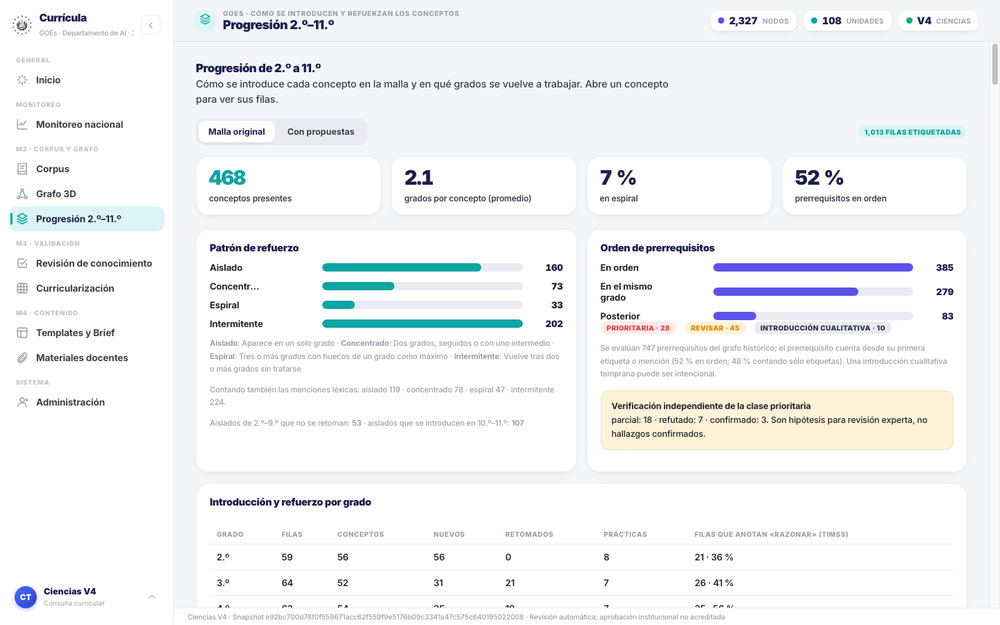
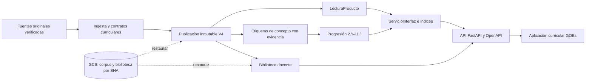

<div align="center">
  
  <h1>GOEs · Science Knowledge Graph</h1>
  <p><strong>Departamento de AI · Gobierno de El Salvador · 2026</strong></p>
  <p>Ingeniería curricular de Ciencias con evidencia verificable, revisión especializada y trazabilidad.</p>

[](docs/badges/medicion.json)
[](docs/badges/medicion.json)
[](docs/badges/medicion.json)
[](pyproject.toml)
[](docs/APLICACION_CIENCIAS.md)
[](https://github.com/carlosjimenez-arch/goes-science-kg/actions/workflows/quality.yml?query=branch%3Afeat%2Fapi)

[Aplicación y API](docs/APLICACION_CIENCIAS.md) · [Arquitectura](docs/ARQUITECTURA.md) · [Operación](docs/OPERACION.md) · [Calidad](docs/CALIDAD.md) · [Documentación](docs/README.md)
</div>

## Propósito

GOEs Science KG organiza la evidencia curricular de **Biología, Física, Química y Ciencias de la
Tierra y del Espacio** de 2.º a 11.º para El Salvador. Conserva el currículo original del MINED, registra
propuestas por objetivo, describe cómo se introduce y refuerza cada concepto entre grados y ofrece una
biblioteca para preparar clases. Cada resultado conserva sus fuentes y los dictámenes que lo sustentan.

Es **un solo producto**: currículo V4 con propuestas revisadas, grafo de conocimiento con progresión
2.º–11.º, biblioteca docente, API y aplicación. Los datos viven en el bucket institucional y se restauran
con recibos verificables. **Cuando no hay una publicación válida, la API responde 503 y la aplicación
muestra «No hay datos disponibles».** El respaldo automático y las verificaciones por agentes son
resultados técnicos: la aprobación institucional y la eficacia de aprendizaje requieren evidencia propia.



## Producto disponible

Publicación `producto-4`, snapshot `e92bc700d78f0f559671acc62f559f9e5176b09c3341a47c575c640195022008`.

| Componente | Contenido |
|---|---|
| Currículo | 1.020 filas originales; 1.013 propuestas de Ciencias y 7 filas fuera de alcance preservadas |
| Revisión | 108 unidades con cuatro dictámenes; 30 filas originales conservan alerta científica |
| Grafo publicado | 2.327 nodos y 7.304 relaciones con fuente verificable |
| Progresión 2.º–11.º | 1.314 etiquetas de concepto con evidencia literal, 468 trayectorias, triaje de prerrequisitos verificado |
| Biblioteca docente | 2.867 registros: preparaciones por objetivo (1.013) y por unidad (108), paquetes V3 y bancos históricos |
| Guiones de clase | 968 respaldados automáticamente y 45 con veto o abstención; **en desarrollo, no publicados** |

Hallazgos principales de la progresión: el refuerzo es mayoritariamente **intermitente** (202 de 468
conceptos vuelven tras dos o más grados de ausencia y sólo 33 forman una espiral continua); Química es la
disciplina más fragmentada; Tierra y espacio termina en 9.º; las prácticas científicas sí se refuerzan de 2.º a
11.º. [Método, verificación y límites](docs/PROGRESION_2_11.md).

No hay datos conectados de escuelas, territorio, resultados LXP o usuarios institucionales. Esas vistas
declaran su ausencia. El ledger registra 4.442 invocaciones históricas; la reserva no equivale a una factura.

## Puesta en marcha

Requisitos: Python 3.11 o superior, `uv` y, para restaurar, `gcloud` con la cuenta GOES y acceso de lectura
al bucket. Si `gcloud storage` falla con Python 3.14, el código elige un Python 3.13/3.12/3.11 instalado o
respeta `CLOUDSDK_PYTHON`.

```bash
make producto                          # uv sync + descarga desde GCS de lo que falte + servicio en :8010
uv run --frozen gskg datos estado      # qué está al día frente a los recibos
uv run --frozen gskg datos verificar   # cotejo por SHA contra el inventario remoto
```

Abrir [la aplicación](http://127.0.0.1:8010/app/) o [OpenAPI](http://127.0.0.1:8010/docs). La consulta,
exportación y compilación de briefs no invocan modelos. Sin corpus se puede abrir la aplicación y comprobar
`/health/live`; `/health/ready` responde 503 hasta que la publicación esté disponible.

## Datos en el bucket

El repositorio no contiene matrices, PDF, snapshots, SQLite ni resultados: todo vive en
`gs://goes-ai-kg-artefactos/ciencias/v4/`, con objetos nombrados por SHA que nunca se sobrescriben.

| Recibo | Contenido |
|---|---|
| `config/datos_ciencias.lock.json` | Corpus completo: 13.919 archivos y 41 SQLite, incluidos fuentes, publicación, guiones, ledgers y progresión |
| `config/materiales_ciencias.lock.json` | Biblioteca docente sola, para consumidores que no necesitan el corpus |

El recibo vigente se restauró en un checkout limpio y la aplicación completa funcionó con esos datos.
[Restauración y límites](docs/DATOS_EXTERNOS.md) · [verificación GCS](docs/VERIFICACION_GCS.md) ·
[alcance de publicación](docs/PUBLICACION.md).

## Aplicación y API

| Sección | Información real |
|---|---|
| Inicio | Estado y alcance de la publicación seleccionada |
| Monitoreo nacional | Balance curricular por grado; ausencia explícita de métricas escolares |
| Corpus | Fuentes registradas y citadas, versiones, SHA y enlaces disponibles |
| Grafo 3D | Nodos y relaciones tipadas con filtros y alternativa tabular |
| Progresión 2.º–11.º | Introducción y refuerzo de conceptos, prerrequisitos tardíos y entrada a bachillerato |
| Revisión de conocimiento | Dictámenes registrados por unidad, rol y ronda |
| Curricularización | Comparación original/propuesta, indicadores, didáctica y alertas |
| Templates y Brief | Organización documental de propuestas respaldadas, sin nueva generación |
| Materiales docentes | Preparaciones por objetivo y unidad, bancos históricos y descargas |
| Administración | Identidad del snapshot, permisos locales y actividad registrada disponible |

| Método | Ruta | Resultado |
|---|---|---|
| GET | `/health/live`, `/health/ready` | Proceso disponible; publicación íntegra y disponible |
| GET | `/api/v4/interfaz/resumen` | Conteos, grados, disciplinas e integraciones |
| GET | `/api/v4/interfaz/filas[/{id}]` | Filtros y paginación; original, propuesta, evidencia y alertas |
| GET | `/api/v4/interfaz/documentos` | Fuentes verificables de la publicación |
| GET | `/api/v4/interfaz/grafo`, `/nodos/{id}` | Subgrafo real con recorte explícito; nodo y relaciones |
| GET | `/api/v4/interfaz/progresion[/conceptos[/{id}]]` | Patrones, prerrequisitos y trayectorias 2.º–11.º |
| POST | `/api/v4/interfaz/briefs` | Briefs documentales de 1–20 objetivos |
| GET | `/api/v4/interfaz/exportaciones/matriz.xlsx` | Matriz completa original/propuesta |
| GET | `/api/v4/materiales[/detalle/{id}][/descarga/{id}]` | Biblioteca docente de sólo lectura |

Los filtros inválidos reciben 422; una identidad ajena, 404; una publicación incompatible, 409; la ausencia o
alteración de evidencia, 503. [Contrato completo](specs/17_aplicacion_curricular.md) ·
[biblioteca](docs/MATERIALES_DOCENTES.md) · [guiones](docs/CLASES_V4.md).

## Arquitectura



| Directorio | Responsabilidad |
|---|---|
| `curriculo/`, `ingesta/` | Lectura y trazabilidad de fuentes originales |
| `producto/` | Publicación V4, consulta, exportación, conceptos y progresión |
| `interfaz/` | Servicios, contratos y assets locales de la aplicación |
| `materiales/`, `clases/` | Biblioteca docente y guiones con cuatro lectores (código congelado por campaña) |
| `motor/`, `recuperacion/` | Generación explícita, revisiones, abstención, presupuesto y recuperación |
| `operacion/` | Respaldos, almacenamiento GCS y recuperaciones verificadas |
| `cli/` | Comandos `gskg` sobre los mismos casos de uso |
| `grafo/`, `aprendizaje/`, `internacional/` | Pipeline histórico y prototipos documentados |

Estas rutas viven bajo `src/goes_science_kg/`. [Decisiones de arquitectura](docs/ARQUITECTURA.md) ·
[referencia `eor-api`](docs/REFERENCIA_EOR_API.md).

## Calidad y reproducibilidad

```bash
make lint       # reglas y formato uniforme
make cobertura  # suite completa, cobertura real y badges fechados
make auditoria  # dependencias, documentación y candidatos a limpieza
make pruebas-js # regresiones de navegación con Node.js 24
```

Los badges superiores se generan desde JUnit y cobertura XML de una ejecución local completa;
[la medición](docs/badges/medicion.json) conserva fecha, denominadores y huella del código.
El porcentaje aprobado y la cobertura de líneas son métricas distintas. GitHub Actions comprueba
un conjunto portable de contratos con datos sintéticos y conserva sus informes. El badge de CI
enlaza el estado remoto de `feat/api`; sus resultados son independientes de la medición local.

Los docstrings mantenidos están en inglés y el formato se controla con Ruff. Dos extractores y el código de
guiones (`clases/`) conservan sus bytes y docstrings históricos porque identifican evidencia publicada. La excepción,
la retirada de código desconectado y los límites de la auditoría están en [Calidad](docs/CALIDAD.md).
La [política de versionado](docs/auditoria/GITIGNORE_2026.md) protege secretos, corpus, SQLite y
respaldos, conservando visibles el código, los contratos, los recibos de restauración y los badges.

## Documentación y contribución

[Índice vigente](docs/README.md) · [Guía de contribución](CONTRIBUTING.md) ·
[Auditoría de producto 2026-10-25](docs/auditoria/QA_PRODUCTO_20261025.md) ·
[Auditoría de la API](docs/auditoria/REVISION_API_2026.md) · [Especificaciones](specs/README.md).
El [QA posterior independiente](docs/auditoria/QA_SEGUNDA_REVISION.md) documenta los fallos
reproducidos, sus correcciones y los límites de la revisión.
Los informes históricos conservan sus fechas, cifras y decisiones; no sustituyen el estado actual.

El código pertenece al equipo GOEs. Los documentos originales pertenecen a sus autores y conservan
sus condiciones de uso. [Fuentes y atribuciones](NOTICE).
