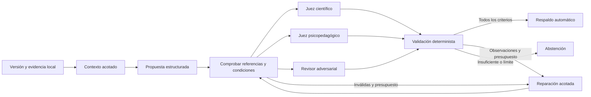

# Arquitectura del motor curricular

La reconstrucción conserva el grafo y el pipeline anterior como referencia reproducible. Las capacidades nuevas tienen contratos de aplicación y adaptadores separados; la CLI es un paquete de grupos, con el mismo entrypoint `goes_science_kg.cli:app`. La CI portable y la medición integral local se describen en [Calidad](CALIDAD.md).

```text
ingesta/         Fuentes y matriz local → inventario y unidades curriculares
curriculo/       Ingesta V4 rica → contratos, clasificación y contexto por celdas
producto/        Generaciones verificadas → diagnóstico, explorador y runtime
grafo/           Contratos existentes → artefacto determinista y validación
recuperacion/    Documentos versionados → rankings léxico/denso/grafo
motor/           Contexto → propuesta → revisiones → puerta de publicación
operacion/       Recuperación única de transporte, sin repetir respuestas ni votos
cli/             Argumentos y JSON → casos de uso
observabilidad   Terminal semafórica y log de operación
```

## Aplicación y lectura HTTP · feat/api

`api.py` compone FastAPI, OpenAPI y la aplicación. `producto/lectura.py::LecturaProducto` concentra
la carga verificada, exclusión de inicialización e invalidación de una generación. Todos los routers
V4 comparten ese lector; readiness no crea otro runtime. `/health/live` comprueba el proceso y
`/health/ready` exige una publicación íntegra.
El lector resuelve las fuentes y ambos archivos de alertas desde su base explícita. Una copia
alternativa no hereda las alertas derivadas del checkout que ejecuta el proceso.

`interfaz/servicio.py` separa el servicio de consultas y verificación física del adaptador HTTP.
`RegistroActividad` abre SQLite en sólo lectura y distingue una campaña ausente de gasto cero.
`interfaz/consulta.py` indexa texto normalizado, grado, disciplina, adyacencia y aristas por nodo;
los filtros y detalles reutilizan esos índices. El lector revalida el snapshot antes de cada consulta.
`interfaz/contratos.py` define los esquemas públicos del listado, fuentes, subgrafo y briefs.

`observabilidad_http.py::ObservabilidadHTTP` es middleware ASGI sin exportadores: genera un ID por
petición, mide tiempos y emite eventos con plantilla de ruta y estado. No carga proveedores remotos.
La [referencia de ingeniería](REFERENCIA_EOR_API.md) documenta la comparación con `eor-api`.

Los IDs de conceptos admiten `/` a través del convertidor de ruta; sólo se buscan en el índice y
nunca se interpretan como rutas del sistema. La ausencia de datos produce un error explícito sin
exponer rutas locales. CSV y Excel declaran la identidad de snapshot en su cabecera de descarga.
Excel fija fechas internas para producir bytes reproducibles y protege los textos de todas sus hojas.
La interfaz confirma los briefs sólo si siguen vigentes la visita, el formato y la selección usados.

Los docstrings públicos están en inglés y Ruff comprueba su presencia. Los extractores originales
`ingesta/extraccion.py` y `ingesta/estructurados.py` conservan sus bytes por compatibilidad de evidencia.
La migración de esos identificadores queda fuera de una normalización de estilo. [Calidad](CALIDAD.md).

## Flujo y estados



Los jueces no reciben los dictámenes de sus colegas ni el nombre del redactor. Eso reduce contaminación del proceso, pero no demuestra independencia epistémica cuando comparten proveedor/modelo. Las reparaciones vuelven a juzgarse sobre su huella exacta; no se arrastra una aprobación de un borrador anterior.

## Context engineering

Las instrucciones de sistema se separan de un contenedor JSON de datos no confiables. El contexto tiene versión y presupuesto explícitos; se omiten fragmentos que no caben en vez de cortar citas arbitrariamente. Se separa evidencia primaria de conceptos derivados usados para navegación. El motor hidrata filas de Excel o páginas PDF desde el archivo original y comprueba su SHA-256; un formato no soportado no se transforma silenciosamente en evidencia primaria. El objetivo de la actividad debe citar la malla local vigente, además de las fuentes de las afirmaciones científicas.

Los prompts, schemas, corpus, modelo, configuración y presupuesto identifican la ejecución. El checkpoint no debe continuar sobre una combinación distinta. La caché del modelo usa proyecto, región, modelo, instrucciones, esquema y límite de salida; no guarda credenciales ni se usa para respuestas de estudiantes. Este motor procesa contenido curricular, no perfiles personales.

El redactor selecciona IDs de fragmentos extraídos y verificados; el código reconstruye las citas desde ese registro. No se le pide al modelo que redacte el literal. Esto impide inventar el texto de la cita por construcción, pero no prueba que el fragmento implique la afirmación: esa revisión semántica sigue siendo obligatoria. Las reglas, contratos y módulos del motor también forman parte de la huella de ejecución.

`ingesta/referencias.py` conserva PDF y extracciones como objetos por huella, con manifiesto independiente del grafo. Su consulta sirve para localizar páginas verificables de PISA, ERCE y TIMSS; no cambia el recuperador curricular seleccionado. `ingesta/dimensiones.py` valida las anclas de categorías locales contra esas páginas originales. La identidad documental, la categoría de análisis y la futura alineación de una tarea son contratos diferentes: verificar la primera no acredita las otras dos.

`ingesta/referentes_operativos.py` añade 29 criterios acotados de PISA/ERCE. `ingesta/extraccion.py`
implementa un puerto de páginas con perfiles: revalida bytes, edición y geometría; fija regiones, orden,
versión de PDFplumber y código. La extracción adicional de dos páginas ERCE convive con el raw.
`motor/alineacion.py` prepara evidencia local y documental y reúne tres lecturas ciegas; comprueba
todos los criterios y citas de ambos lados, con unanimidad y abstención. No crea aristas de cobertura.
Antes de reanudar también reconstruye terminales y contrasta el modelo configurado de cada lector;
un resultado persistido no sustituye los dictámenes y evidencias que lo originaron.

`ingesta/estructurados.py` indexa DOCX/HTML por código oficial completo y único. La hidratación conserva
fila XML o sección DOM, texto nativo y huella de implementación, sin paginación ficticia. El índice se
comparte por snapshot bajo el bloqueo de `FuentesVerificadas`; el contexto no toma metadata como fuente.
La visibilidad es estática: no se ejecutan Word, CSS externo ni JavaScript. Ambigüedad o exceso de tamaño
producen rechazo sin recortar evidencia. Los modelos y jueces siguen sujetos a sus límites de contexto.

Las referencias de países tienen su propio manifiesto y catálogo; comparten el adaptador PDF, con SHA
esperado antes de extracción y TLS verificado con el sistema más `certifi` fijado. Original, traducción,
comentario, modalidad y cohorte son campos de procedencia. Ingerir páginas no crea objetivos ni relaciones.
La política de descubrimiento puede fijar ediciones concretas; juicio semántico y progresión son pasos aparte.

`producto/conocimiento.py` genera hipótesis verificables sobre alias, comparaciones extranjeras y
dependencias históricas; mantiene vacíos los enlaces y DAG aceptados. `producto/unidades.py` conserva
las filas de una unidad y orquesta el `Motor` existente por sesión, con un ledger compartido, checkpoints
vinculados al entorno y control de anclaje en la fila solicitada. `motor/ejecuciones.py` concentra la
reanudación durable utilizada por la CLI, la alineación y las unidades. Preparar no activa inferencias.

`producto/juicios.py` verifica candidatos y rehidrata la fila completa, fuentes primarias y soportes
semánticos por grupo. `motor/conocimiento.py` reúne cuatro lectores ciegos con rúbricas científicas,
curriculares, psicopedagógicas y adversariales. Cada relación respaldada queda condicionada a su fila,
sin equivalencia de grados. `producto/relaciones.py` reconstruye los terminales de los lotes indicados,
rechaza rondas duplicadas y bloquea admisión ante ciclos, sin borrar los respaldos conflictivos.
La CLI `producto juicios` comparte Registro/checkpoints y usa un puerto sin generación para consolidar.
`motor/validacion_conocimiento.py` concentra el cierre puro que comparten motor y archivo publicado.
`producto/conocimiento_publicado.py` deduplica evidencias y reconstruye dictámenes, grupos y cierres
contra las celdas originales. La publicación `producto-2` incluye `conocimiento.json`; el constructor
rehidrata sus fuentes antes de integrarlo. `producto/grafo_conocimiento.py` representa cada relación
en un nodo condicionado a la fila, con extremos separados; no crea prerrequisitos globales.
`producto/consulta_conocimiento.py` recupera únicamente vínculos admisibles para `Solicitud.fila_id`,
sin saltar entre filas. Las unidades siempre solicitan esa identidad; el Motor comprueba el anclaje
antes de los jueces. Búsquedas sin fila conservan el baseline. La publicación actual reúne quince
juicios originales: dos respaldados, seis rechazados y siete abstenciones. La composición conserva
los protocolos y hashes individuales, junto con una vista conjunta deduplicada; revalida componentes,
rechaza candidatos repetidos y comprueba ciclos entre cohortes. No hay progresiones reales acreditadas. [Contrato y límites](juicios_conocimiento.md).

La compatibilidad de hashes de los archivos originales requiere omitir `componentes` cuando está
vacío. `Field(exclude_if=...)` se incorporó en Pydantic 2.12; el paquete declara `>=2.12,<3` y el lock
fija la versión utilizada. Así se evita admitir una instalación anterior que ignore esa opción y
cambie la serialización. [Nota de versión oficial](https://pydantic.dev/articles/pydantic-v2-12-release).

`producto/alineaciones.py` conserva la cohorte documental completa y reconstruye el cierre puro de
`motor/alineacion.py`; no repite votos ni reinterpreta el contexto histórico. `producto-3` añade el noveno
archivo `alineaciones.json` y mantiene lectura de `producto-2`. Su grafo vincula respaldo, fila y criterio
local mediante tipos propios. `FuentesConAlineaciones` relee la extracción con el perfil original;
`BuscadorProducto` limita sus páginas a la fila admitida. El contexto reserva esas páginas y al menos un
fragmento de cada una, contando su lectura completa. Presupuesto insuficiente produce abstención.
[Contrato y pruebas](investigacion/integracion_alineaciones_v4.md).

La API fija un grafo por instancia y comprueba publicaciones de derivados por artículo. Los generadores registran sus entradas y salidas; el lector rechaza una procedencia ausente o archivos mutados. El [contrato de publicación](investigacion/coherencia_api.md) explicita disponibilidad, regeneración y costo de E/S.

## Harness independiente del editor

La publicación V4 usa generaciones inmutables y un puntero atómico independiente del histórico.
Su runtime indexa los mismos nodos y relaciones ya verificados por el lector de la generación;
no vuelve a cargar un grafo mutable después de comprobarlo. El contexto selecciona celdas por
prioridad curricular y presupuesto completo de JSON. Las alertas científicas documentadas se
revalidan por fuente y ancla y bloquean propuestas cuando sus filas forman parte del contexto.
El explorador conserva las filas bloqueadas, pendientes o fuera de alcance para hacerlas revisables.

El [candidato agentic](investigacion/agentic_v4.md) admite una reformulación y una búsqueda adicional,
con filtros fijos y sin herramientas abiertas. Está separado del runtime predeterminado hasta superar
el gate de calidad por grado, coste y latencia; implementarlo no demuestra que mejore la recuperación.

- Contratos Pydantic con campos inesperados rechazados.
- Herramientas de lectura deterministas; el modelo no ejecuta shell ni modifica archivos fuente.
- IDs de fuente, citas y versiones comprobados antes de publicar.
- Criterios obligatorios explícitos por rol; no se acepta un diccionario vacío de evaluación.
- Presupuesto SQLite con reserva transaccional antes de cada intento pagado; sobrevive a reinicios.
- Reintentos solo para errores transitorios; no se repiten errores de permisos, configuración o contrato.
- Timeout, concurrencia y número de reparaciones limitados.
- Checkpoints LangGraph persistidos sincrónicamente en SQLite local.
- Salida de abstención sin propuesta publicable ante evidencia o revisiones insuficientes.

Las guardas de `.claude/` se conservan para el pipeline histórico, pero las garantías anteriores se ejecutan dentro del runtime y no dependen del editor.

## GCP y AIOps

Vertex usa ADC y un proyecto/ubicación explícitos. Los modelos se seleccionan desde configuración; los defaults históricos Gemini 2.5 no se trasladan a la reconstrucción porque su ciclo de vida cambió. La reserva usa tarifas conservadoras configuradas y una cota de tokens; es una protección operativa, no una factura. Se registran tokens reportados por el proveedor, razonamiento cuando está disponible, estado, modelo, rol y latencia.

La operación local usa `data/operaciones/`, ignorado por Git: registro de llamadas, caché, checkpoints y logs. El despliegue futuro puede sustituir el repositorio de checkpoints por PostgreSQL y exportar eventos a Cloud Logging; no se aprovisiona infraestructura persistente sin evidencia de necesidad. El tamaño actual del grafo permite comparar índices locales antes de contratar un servicio vectorial.

## Límites de publicación

`respaldado_automaticamente` indica que una salida pasó las reglas y los jueces de esa ejecución. No significa aprendizaje demostrado, ítem calibrado, currículo oficial ni confirmación del MINED. El estado de evidencia empírica se conserva aparte; no se obtiene por votación de agentes.


## Curricularización completa y publicación producto-4

`producto/preparacion_mejoras.py` conserva una unidad completa, las fases presentes/ausentes y sus
celdas verificadas. Deduplica sólo cadenas idénticas; no resume ni recorta exigencias. Los párrafos
científicos se rehidratan por DOM/SHA y las expectativas nativas por región PDF, encabezado y extremos.
`recuperacion/ciencia_web.py` separa este índice auxiliar de la recuperación curricular seleccionada.

`motor/mejoras.py` implementa contexto → redacción → contrato → cuatro revisiones ciegas → cierre.
Permite una reparación real; el mismo borrador vetado no vuelve a votarse. Ciencia, currículo,
psicopedagogía y adversarial tienen rúbricas completas; ningún criterio negativo se compensa por mayoría.
La gramática de transporte reduce complejidad para Vertex; Pydantic aplica el contrato local íntegro.
El ledger conserva incluso salidas inválidas y las recupera sin nueva invocación al reanudar.

`producto/seguimiento_mejoras.py` registra un protocolo finito sobre todas las incidencias de una campaña,
con sus antecedentes completos. Recupera sólo lecturas ausentes si las demás aprueban el mismo borrador;
los vetos requieren modificación sustantiva. No reevalúa unidades aprobadas ni reinicia el presupuesto.
`operacion/fondos.py` reserva la cota completa de las unidades en curso y el ledger impone el límite por
llamada. Un lock serializa campañas del mismo presupuesto. Los checkpoints conservan la huella del
código, prompts, contexto, contrato y modelos; cambios incompatibles impiden reanudar silenciosamente.

`mejoras_publicadas.py` exige el denominador íntegro, reconstruye los cierres y valida cinco controles
adversariales. `grafo_mejoras.py` publica `RevisionUnidad`, `MejoraCurricular` y `ExpectativaNativa`, con
relaciones propias. No añade cobertura internacional ni prerrequisitos locales por orden documental.
`producto-4` conserva diez archivos verificados en una generación inmutable. La API invalida su instancia
si cualquiera cambia, incluso cuando se restaura después. Los formatos producto-2/3 siguen admitidos.

La exportación conserva el original y muestra la propuesta y sus condiciones en Excel, CSV y HTML.
Escapa texto y fórmulas; las enmiendas de Excel cambian sólo las celdas aceptadas en copias derivadas y
verifican todas las celdas/estilos después. El runtime no indexa las propuestas como evidencia primaria.

`operacion/almacen_gcs.py` comprueba identidad, proyecto, acceso uniforme y prevención pública efectiva
por cada escritura. Crea objetos nuevos, fija generaciones y verifica sus SHA mediante descarga.
`datos_externos.py` restaura el corpus por inventario. `presupuestos_restaurados.py` migra sólo la identidad
física de los vínculos a ledgers íntegros; no borra llamadas ni reinicia reservas. No hay infraestructura
nueva, IAM modificado ni CI. [Procedimiento](DATOS_EXTERNOS.md), [resultados](CURRICULARIZACION_V4.md).


La rectificación científica documentada se registra en `producto/rectificacion_mejoras.py`: conserva el
falso positivo previo, añade evidencia primaria, exige otro borrador y cuatro votos nuevos, y no convierte
la observación técnica en un voto inventado. El publicador bloquea la omisión de esa rectificación conocida.
La copia derivada puede corregir una celda, pero el runtime sigue bloqueando su original erróneo para que
la generación genérica no lo enseñe como evidencia correcta. Los ensayos anteriores permanecen auditables.

## Aplicación GOES conectada al snapshot

La aplicación y sus assets se sirven desde el mismo proceso FastAPI, en `/app/`. El router
`api_interfaz.py` recibe el lector de `api_producto.py`; cada consulta revalida ese lector antes de usar
la proyección indexada en `interfaz/consulta.py`. No hay una semilla de demostración ni otro grafo
cargado por el frontend. El navegador coteja las identidades de respuesta para evitar mezclar snapshots.

Los módulos JS separan cliente HTTP/escape, iconos, proyección 3D y orquestación de vistas. El grafo
renderizado preserva los tipos de arista y declara el recorte. El brief es una compilación documental
sobre propuestas respaldadas; verifica el original y no invoca el motor. El ledger operativo se lee
sin escrituras. [Contrato y límites de integración](../specs/17_aplicacion_curricular.md).
