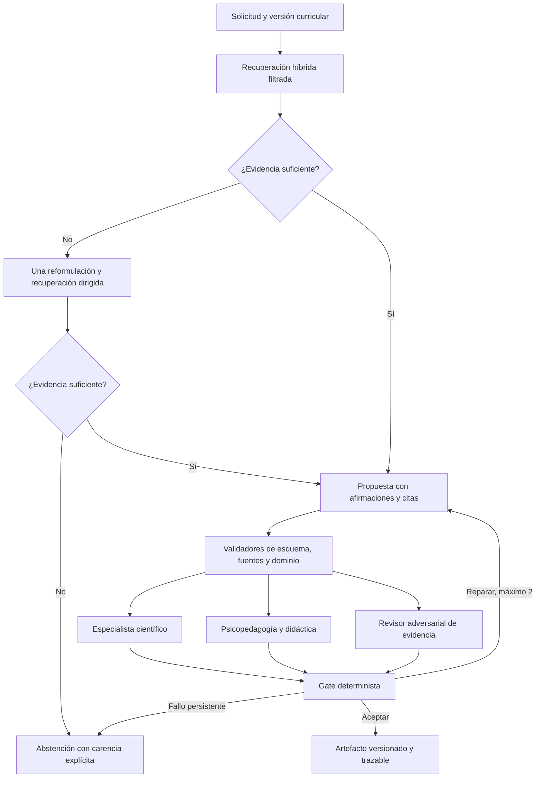

# Arquitectura de IA, recuperación y evaluación

> Registro histórico de investigación. Describe el corte y la ejecución indicados en este documento.
> Estado vigente del código, API y métricas: [documentación actual](../README.md) y [calidad](../CALIDAD.md).

Fecha de investigación: **21 de octubre de 2026**, zona horaria del usuario: América/Bogotá.
Estado: decisiones iniciales contrastadas con fuentes primarias y mediciones locales. La superioridad
educativa de una arquitectura o un modelo **no está demostrada** por estas mediciones. La ingestión V4
ya está ingerida y publicada. Las propuestas iniciales de recuperación de este documento deben leerse
junto con los experimentos posteriores: el runtime conserva el baseline; el híbrido y el wrapper
agentic no son el recuperador predeterminado. La integración de quince juicios y la lectura primaria
completa se documentan en [continuación de Ciencias](continuacion_ciencias_20261021.md).

## 1. Decisión de arquitectura

Construir un producto orientado a evidencia: ingesta versionada → recuperación → propuesta estructurada
→ validación automática → especialistas independientes → reparación limitada → aceptación o abstención.
El grafo mantiene conceptos, prerrequisitos, objetivos, evidencias y equivalencias; los modelos proponen
relaciones y materiales, y el código decide si cumplen los contratos verificables.

Usar **LangGraph para la orquestación con estado**, no para reemplazar las operaciones deterministas del
dominio. Su documentación distingue workflows de rutas previstas y agentes con decisiones dinámicas;
en este caso las revisiones y los límites deben ser explícitos. Los checkpoints permiten reanudar
ejecuciones; la memoria RAM no sobrevive a un reinicio. Empezar con SQLite local y diseñar el cambio a
PostgreSQL para ejecución distribuida. Las operaciones con efectos deben ser idempotentes, con claves
por artefacto y versión. Fuentes: [workflows](https://docs.langchain.com/oss/python/langgraph/workflows-agents),
[persistencia](https://docs.langchain.com/oss/python/langgraph/persistence).

La ejecución puede operar sin una persona aprobando cada resultado: si no alcanza los criterios,
se abstiene automáticamente. Esto reduce la dependencia operativa de revisión manual; no constituye
evidencia de que se puede garantizar precisión científica o eficacia educativa sólo con IA.

## 2. Qué conservar y qué corregir del repositorio

| Componente inspeccionado | Reutilización | Cambio necesario |
| --- | --- | --- |
| `rag.py` | Baseline BM25 y expansión curricular determinista | Nueva recuperación híbrida separada, sin romper evaluaciones antiguas |
| `modelos.py`, `lotes.py` | Contratos e identificadores | Contratos de evidencia, versiones y condiciones de abstención |
| `panel.py`, `bucle.py`, `config/panel.yaml` | Roles, refutación y verificación de citas | Revisiones independientes, rúbricas calibradas y máximo de rondas |
| `aprendizaje/fidelidad.py` | Verificación literal de afirmaciones y respaldo | Medir omisiones y relación semántica: la mera presencia de una cita no demuestra sustento |
| `internacional/vertex.py` | SDK `google-genai`, ADC, hashes de adjuntos | Uso real de tokens/coste, timeout, errores clasificados, versiones de modelo y caché atómica |
| `.claude/hooks`, `tests/test_harness.py` | Guardas del entorno de desarrollo | Harness portable de ejecución del producto; los hooks de un editor no bastan |
| `data/evaluacion` | Casos de regresión históricos | Etiquetas vigentes V4, separación train/dev/test y manifiesto inmutable |

El cliente antiguo usa por defecto `gemini-2.5-pro` para validar/etiquetar y un preview para extraer.
La documentación oficial de ciclo de vida fija el retiro de la familia 2.5 el **20 de octubre de 2026**.
La selección debe hacerse por configuración y prueba de capacidad real del proyecto; nunca por
presumir que un nombre configurado sigue disponible.
[Ciclo de vida oficial](https://docs.cloud.google.com/vertex-ai/generative-ai/docs/learn/model-versions).

## 3. Context engineering y contratos

Preparar un paquete de contexto por ejecución que incluya: versión y hash del currículo, objetivo y
grado, conceptos/prerrequisitos pertinentes, fragmentos de fuentes con localizadores, correspondencia
de marcos, restricciones del aula salvadoreña y rúbrica de salida. Cada fragmento tiene un identificador
estable, texto exacto y SHA-256; una respuesta nunca cita un resumen como si fuera una fuente primaria.

Separar instrucciones de datos recuperados. El contenido documental no obtiene permisos de ejecutar
comandos ni de cambiar las reglas. El recuperador aplica filtros de versión/grado/asignatura antes del
ranking; la expansión del grafo respeta dirección, tipos de relación, profundidad y presupuesto. La
inclusión de fuentes internacionales no convierte una recomendación extranjera en norma de El Salvador.

Mantener un límite de contexto explícito, deduplicar y conservar fragmentos con evidencia directa.
Registrar lo excluido y el presupuesto consumido. Los resúmenes conservan punteros a fuentes, con
etiqueta de derivación; no reemplazan al texto original para validar una afirmación. El contexto del
juez contiene el artefacto y las fuentes, no los argumentos del redactor ni otros dictámenes en la
primera ronda. La evidencia de posiciones en contextos largos justifica medir tamaño/orden, no asumir
que un contexto más largo mejora siempre el resultado.
[Lost in the Middle](https://arxiv.org/abs/2307.03172).

Esta propuesta aplica la curación iterativa del contexto —instrucciones, datos, herramientas y estado—
descrita por la ingeniería de Anthropic; no adopta su marca de modelo como requisito.
[Context engineering](https://www.anthropic.com/research/effective-context-engineering-for-ai-agents).

Contratos recomendados:

- `Evidence`: fuente, versión, localizador, texto, huella, autoridad y fecha de consulta.
- `Claim`: afirmación, evidencias que la respaldan, tipo de inferencia y limitaciones.
- `Proposal`: objetivo, afirmaciones, actividad/evaluación, recursos y duración.
- `Review`: rol, criterios, fallos por severidad, evidencias, decisión y modificaciones solicitadas.
- `Run`: versiones de código/prompts/modelos/datos, estado, métricas, presupuesto y motivo de cierre.

Usar respuesta JSON con esquema del proveedor y validar otra vez en Pydantic. El proveedor soporta
un subconjunto del esquema y puede ignorar campos no admitidos. Un JSON válido no demuestra verdad
científica ni correcta adaptación escolar.
[Salida estructurada](https://cloud.google.com/vertex-ai/generative-ai/docs/multimodal/control-generated-output).

## 4. Recuperación: baseline, híbrida y agencia acotada

No existe evidencia suficiente para elegir Agentic RAG por su nombre. Comparar cuatro sistemas sobre
las mismas preguntas y fuentes:

1. BM25 y grafo existente como referencia económica.
2. BM25 por índice invertido + embeddings multilingües + Reciprocal Rank Fusion (RRF).
3. Híbrido + expansión dirigida de prerrequisitos/alineaciones y, si aporta, reranking.
4. Variante anterior + una reformulación/segunda recuperación activada por carencia identificable.

RRF combina posiciones de rankings sin asumir que coseno y BM25 tienen escalas equivalentes. La
implementación local debe calcular similitud por producto matricial sobre vectores normalizados,
validar dimensiones/modelo/hash del corpus y cachear embeddings por contenido. Para el corpus actual
de pocos miles de nodos no se justifica de entrada un servicio vectorial dedicado: medir RAM, p95 y
relevancia antes de añadir infraestructura.

El GraphRAG de Microsoft usa comunidades y resúmenes para preguntas globales sobre un corpus. Es una
opción para informes transversales; no demuestra que los resúmenes sean superiores para localizar una
fila curricular concreta. Las preguntas globales pueden usar agregación determinista y síntesis con
citas, conservando el detalle para auditoría.
[GraphRAG, artículo original](https://arxiv.org/abs/2404.16130).

Self-RAG estudia recuperación adaptativa con un modelo entrenado y tokens de reflexión; CRAG incorpora
evaluación de recuperación y acciones correctivas. Sus resultados motivan el experimento, pero no
equivalen a demostrar que añadir un prompt de reflexión reproduce los modelos del artículo.
[Self-RAG](https://arxiv.org/abs/2310.11511), [CRAG](https://arxiv.org/abs/2401.15884).

La segunda búsqueda debe señalar qué falta —por ejemplo, un descriptor ERCE o la edad del grado
extranjero— y terminar con evidencia nueva o abstención. En el producto educativo, la web abierta no
debe ampliar silenciosamente el corpus aprobado; la investigación incorpora fuentes mediante ingesta
con huellas y procedencia.

## 5. Especialistas, psicopedagogía y límites de los jueces

| Revisión | Rúbrica y comprobación |
| --- | --- |
| Ciencias: Biología/Física/Química/Tierra y Espacio según el tema | Exactitud conceptual, unidades, cálculos, modelos, límites, prerrequisitos y seguridad experimental |
| Psicopedagogía y didáctica | Demanda cognitiva, vocabulario, carga de lectura, accesibilidad, concepciones previas, andamiaje, evaluación y viabilidad de aula |
| Evidencia y comparación internacional | Autoridad de fuente, cita exacta y suficiente, versión, equivalencia de edades/grados, núcleo/electiva, inferencias y contraejemplos |
| Gate determinista | Esquema, fuentes existentes, citas presentes, roles completos, errores críticos, presupuesto, rondas y estado final |

Los nombres de rol no acreditan a un profesional real. Cada rol necesita ejemplos positivos/negativos,
casos adversariales y una rúbrica versionada. No pedir acuerdos por mayoría: tres revisores del mismo
modelo pueden compartir errores. Mantener el rechazo científico o de seguridad como bloqueo, incluso
si otros puntajes son altos. Para reparar, entregar fallos concretos y fuentes; volver a evaluar el
artefacto completo, sin heredar aprobaciones de una versión anterior.

Zheng y colaboradores documentan sesgos de posición, longitud y autoevaluación en jueces LLM. El
acuerdo con preferencias humanas de su benchmark no acredita exactitud curricular. Para evaluaciones
por pares, ocultar marca del autor y alternar orden; para exactitud usar referencias y contraejemplos.
[MT-Bench y Chatbot Arena](https://arxiv.org/abs/2306.05685).

Huang y colaboradores encuentran límites de autocorrección sin retroalimentación externa en las
tareas estudiadas. La corrección debe traer evidencia o validación nueva, no únicamente repetir
«piensa otra vez».
[Autocorrección](https://arxiv.org/abs/2310.01798).

El estudio MAST identifica fallos de diseño, coordinación y verificación en sistemas multiagente.
La aplicación propuesta minimiza comunicación libre, define responsables y limita iteraciones;
la diversidad de roles o modelos se evalúa como hipótesis, no como garantía.
[Why Do Multi-Agent LLM Systems Fail?](https://arxiv.org/abs/2503.13657).

## 6. Harness de ejecución y AIOps

El harness es el código que controla el experimento y la operación: carga configuración, limita
herramientas, valida entradas/salidas, asigna presupuesto, persiste pasos, maneja fallos y produce
trazas comparables. Debe funcionar igual desde CLI, notebook o API.

- Fijar máximo de llamadas, tokens, USD estimados, tiempo total y dos reparaciones; reservar presupuesto
  antes de enviar cada petición y reconciliarlo con `usage_metadata` al finalizar.
- Registrar coste de borradores rechazados y jueces: coste por artefacto aceptado, no por llamada.
- Clasificar 401/403 como credenciales/permisos y 400/esquema como configuración; no reintentarlos de
  manera ciega. Aplicar backoff con jitter y tope a 429, 5xx y fallos transitorios.
- Persistir JSONL de eventos y checkpoints; escribir cachés de forma atómica y usar claves que incluyan
  esquema, parámetros, prompts, modelo y corpus. Un alias mutable necesita control de vigencia.
- Verde: paso aceptado; amarillo: reintento, carencia o abstención; rojo: fallo. Incluir etiqueta
  textual, desactivar ANSI fuera de terminal y conservar JSON sin códigos de color.
- No registrar tokens de acceso ni respuestas identificables de estudiantes en trazas generales.
  Separar ejecuciones curriculares de sesiones de aprendizaje.
- Medir cambio de distribución de consultas, fuentes obsoletas, fallos de citas, abstenciones,
  errores por disciplina/grado y ratio de reparación. Revertir versión de prompt/modelo/configuración
  si empeoran los casos de regresión.

Evaluar la salida final y también las trayectorias (herramientas, rutas, fallos y recuperación).
Las ejecuciones repetidas son necesarias para distinguir capacidad ocasional de fiabilidad.
[Evaluaciones de agentes](https://www.anthropic.com/research/demystifying-evals-for-ai-agents).

OpenTelemetry permite instrumentación sin ligar el dominio a un proveedor. Cloud Trace recomienda
OTLP para exportar trazas. Empezar con eventos locales y un adaptador opcional; la observabilidad no
debe requerir servicios cloud para ejecutar las pruebas.
[Cloud Trace](https://cloud.google.com/trace/docs/setup),
[convenciones de IA de OpenTelemetry](https://opentelemetry.io/docs/specs/semconv/gen-ai/).

## 7. GCP: candidatos, eficiencia y coste

Seleccionar candidatos disponibles por proyecto/región y capacidad de salida estructurada. En la
consulta oficial de hoy aparecen `gemini-3.5-flash-lite`, `gemini-3.8-flash` y `gemini-4-argon`;
su inclusión es para comparar coste/calidad, no un ranking de exactitud educativa.
[Modelos y ciclo de vida](https://docs.cloud.google.com/vertex-ai/generative-ai/docs/learn/model-versions).

Referencia de precios globales estándar, USD por millón de tokens, consultada el 21-10-2026:

| Modelo | Entrada | Salida, incluido razonamiento facturable | Condición |
| --- | ---: | ---: | --- |
| Gemini 3.5 Flash-Lite | 0,30 | 2,50 | Tabla estándar |
| Gemini 3.8 Flash | 0,75 | 3,75 | Introductorio hasta 31-12-2026; luego 1,50 / 7,50 |
| Gemini 4 Argon | 2,00 | 10,00 | Promoción hasta 30-11-2026 mediante créditos; luego 4,00 / 20,00 |

La misma tabla ofrece tarifas Batch/Flex diferentes. No presupuestar el descuento sin confirmar
compatibilidad y elegibilidad. Para Argon separar gasto bruto y créditos; las cifras publicadas no
prueban que el proyecto reciba automáticamente la promoción.
[Tarifas oficiales](https://cloud.google.com/vertex-ai/generative-ai/pricing).

Fórmula de referencia: `USD = tokens_entrada * tarifa_entrada / 1e6 +
tokens_salida_facturables * tarifa_salida / 1e6`, agregando embeddings, caché, búsqueda, almacenamiento y
llamadas de revisión. Registrar fecha y tabla de precios en cada experimento. La factura del proyecto
es la conciliación posterior; el harness produce una estimación auditable.

Comparar embeddings `gemini-embedding-001` y `gemini-embedding-2` sobre español científico y consultas
internacionales. La documentación permite reducir dimensionalidad y distingue límites por modelo;
validar truncamiento y no asumir que el tamaño de lote genérico aplica a todos los modelos.
La versión 001 está anunciada al menos hasta mayo de 2028; Embedding 2 incorpora soporte multimodal.
[Embeddings](https://cloud.google.com/vertex-ai/generative-ai/docs/embeddings/get-text-embeddings),
[ciclo de vida](https://docs.cloud.google.com/vertex-ai/generative-ai/docs/learn/model-versions).

Para extracción masiva y evaluaciones usar Batch si el tiempo de cola es aceptable: entradas JSONL en
Cloud Storage, salida por registro, reintento de fallos individuales y huellas para evitar duplicados.
La capacidad compartida puede producir cola; no prometer un p95 interactivo para Batch.
[Batch con Cloud Storage](https://cloud.google.com/vertex-ai/generative-ai/docs/multimodal/batch-prediction-from-cloud-storage),
[cuotas](https://cloud.google.com/vertex-ai/generative-ai/docs/quotas).

Paralelizar llamadas de revisores independientes con un semáforo global y por modelo; medir concurrencia
1/2/4/8 hasta identificar el punto en que 429 o latencia crecen. Calcular los rankings densos por
matmul; no vectorizar llamadas de red sin límites. Usar ADC local y una identidad de servicio con
permisos específicos en despliegue; no persistir claves en el repositorio.
[Autenticación](https://cloud.google.com/vertex-ai/generative-ai/docs/start/gcp-auth).

## 8. Medición local realizada

Ejecución no mutante del 21-10-2026 con `.venv/bin/python`, Python **3.14.3**, grafo de **3.303 nodos y
18.177 aristas**. Hash SHA-256 de `rag.py`:
`a41674dd05dadb84353afbc7a6f11073c94eeffd8d45273d1e2620a54d666fbd`.
Se llamó a `evaluacion.evaluar(GraphRAG(*cargar()), conjunto=...)` para los cuatro conjuntos históricos.
Estos son casos de regresión plata, no un test independiente nuevo ni una evaluación de la V4.

| Conjunto | n | MRR | recall@10 | recall@25 | IDs relevantes ausentes del grafo |
| --- | ---: | ---: | ---: | ---: | ---: |
| `rag_preguntas.json` | 60 | 0,840 | 0,619 | 0,802 | 10 |
| `rag_preguntas_prueba.json` | 16 | 0,671 | 0,668 | 0,829 | 5 |
| `rag_preguntas_prueba2.json` | 12 | 0,558 | 0,583 | 0,694 | 0 |
| `rag_preguntas_prueba3.json` | 12 | 0,735 | 0,600 | 0,858 | 0 |

Los IDs ausentes impiden interpretar recall como cobertura vigente. Debe migrarse la anotación a V4
sin eliminar preguntas difíciles sólo para subir las métricas. Los conjuntos ya usados para ajustar
léxico/pesos no vuelven a ser ciegos.

Tiempo de carga 51,39 ms; construcción de índice 27,48 ms. Recuperación caliente, 60 consultas repetidas
tres veces (180): p50 **1,84 ms**, p95 **2,34 ms**. Es una observación de este host, corpus y ejecución;
no un SLO ni comparación cloud.

Ablación sólo de `saltos=0/1/2` en expansión genérica; se conserva la rama específica de ancestros de
prerrequisitos, por lo que `0` **no equivale a BM25 puro**:

| Conjunto | recall@10, 0 saltos | 1 salto | 2 saltos |
| --- | ---: | ---: | ---: |
| Ajuste 60 | 0,577 | 0,619 | 0,619 |
| Prueba 16 | 0,578 | 0,668 | 0,668 |
| Prerrequisitos 12 | 0,583 | 0,583 | 0,583 |
| Marco 12 | 0,356 | 0,600 | 0,600 |

Uno y dos saltos también obtuvieron MRR idéntico en los cuatro conjuntos. En esta ejecución, un salto
reduce trabajo sin pérdida observada. No se cambiaron los pesos del baseline ni las anotaciones;
la decisión para V4 queda sujeta a un corpus y test vigentes.

## 9. Matriz de experimentos y reglas de selección

Separar `train` para ejemplos/optimización, `dev` para selección y `test` cerrado para una medición final.
Evitar que páginas vecinas, paráfrasis o temas equivalentes se filtren entre particiones. Estratificar
por asignatura, grado, marco, preguntas sin respuesta, contradicciones y limitaciones de recursos.
Un conjunto sintético se etiqueta como tal; un juez que también construyó sus respuestas no constituye
una referencia independiente.

| Experimento | Variantes | Métrica primaria | Coste/tiempo y diagnóstico |
| --- | --- | --- | --- |
| R1 Recuperación | BM25 / híbrido / híbrido+grafo / agencia limitada | recall@10, nDCG@10, MRR, citas recuperables | p50/p95, RAM, tokens de contexto, tasa de segunda búsqueda |
| R2 Embeddings | 001 / 2; 768 / 1536 / 3072 dimensiones donde se soporte | Relevancia multilingüe y por disciplina | Tiempo de indexación, coste, RAM, invalidación al cambiar corpus |
| P1 Prompts | Cero ejemplos / ejemplos / evidencia primero / descomposición explícita | Afirmaciones respaldadas y errores críticos | Tokens, latencia, coste por aceptado, longitud |
| P2 Optimización | Prompts manuales / optimización sobre train-dev | Ganancia en test cerrado | Coste de búsqueda y complejidad; no optimizar contra test |
| W1 Workflow | Un generador / +revisor / tres roles / +reparación | Falsas aceptaciones y errores residuales | Llamadas, p95, tasa de reparación y abstención |
| J1 Jueces | Mismo modelo / modelo distinto / evidencia y contraprueba | Detección de errores sembrados, precisión/recall del rechazo | Sesgo de posición/longitud, acuerdo y falsos positivos |
| C1 Contexto | 4k / 8k / 16k; distinto orden; deduplicación | Fidelidad y cobertura de restricciones | Tokens y latencia; evidencia omitida por recorte |
| O1 Operación | Concurrencia 1/2/4/8; caché fría/caliente | Resultados idénticos según contrato y recuperación de fallos | Throughput, 429, gasto, coste rechazado y reanudación |
| E1 Educación | Unidad validada y piloto de aula | Aprendizaje y transferencia, utilidad docente | Tiempo de preparación, acceso, lectura y recursos |

DSPy proporciona un enfoque de optimización de programas/prompts contra una métrica. Adoptarlo sólo
si mejora sobre la búsqueda controlada simple; añade una hipótesis experimental, no un requisito del
runtime ni una certificación de calidad.
[DSPy, artículo original](https://arxiv.org/abs/2310.03714).

Reglas propuestas, fijadas **antes** de abrir test: no aceptar fallos críticos conocidos, fuentes
inexistentes, mezcla de versiones ni citas inventadas; usar abstención cuando falta información.
Entre variantes que superen esas puertas, elegir la frontera de Pareto calidad/coste/p95 y el workflow
más sencillo sin pérdida relevante. Reportar intervalos por bootstrap pareado cuando el tamaño del
conjunto lo permita y al menos tres ejecuciones de las variantes finalistas. Los umbrales numéricos
de calidad educativa deben calibrarse con casos reales; no derivarlos de puntajes de autoconfianza.

Métricas mínimas de una ejecución: validez de esquema, precisión/recall de citas, fracción de
afirmaciones respaldadas, contradicciones, errores críticos, alineación al objetivo, demanda cognitiva,
viabilidad, tasa de abstención, cobertura entre aceptados, p50/p95, tokens, USD estimados y coste por
aceptado. La abstención sola puede inflar precisión: mostrar conjuntamente calidad y cobertura.

## 10. Orden de implementación

1. Cerrar disponibilidad y versión de V4; manifiesto de fuentes y contratos comunes.
2. Recuperación local híbrida opcional con baseline preservado, filtrado y cachés verificables.
3. Harness portable, eventos estructurados y LangGraph con checkpoints persistentes.
4. Benchmark de prompts/workflows/modelos accesibles con presupuesto pequeño y trazas completas.
5. Selección documentada sobre métricas; ampliación por disciplina y extracción Batch cuando proceda.
6. Piloto pedagógico y actualización de umbrales por evidencia observada.

No se requiere CI en esta fase: los comandos locales de lint, tests, evaluación y regeneración deben
ser suficientes y repetibles. El documento distingue propuestas de diseño de resultados efectivamente
medidos; los experimentos con modelos cloud se registran por separado de esta medición local.

## 11. Implementación y comparación del candidato

Se implementó `goes_science_kg.recuperacion` como candidato independiente del baseline. Incluye
`Documento`, `Resultado`, `Buscador`, `IndiceEmbeddings`, normalización en español, listas invertidas,
RRF y expansión dirigida limitada. Los índices densos validan modelo, dimensiones y corpus; su archivo
NPZ se lee con `allow_pickle=False`. Los filtros de versión/grado/asignatura están preindexados para
evitar normalizar cada documento en cada consulta.

`cargar_buscador_grafo()` valida la versión curricular y carga nodos/aristas una vez. El atributo
`buscador.huella` identifica documentos, relaciones, parámetros y, si existen, vectores; la huella del
corpus textual permanece separada para evitar invalidar embeddings por cambios exclusivos del grafo.
Las referencias derivadas conservan su etiqueta; no adquieren condición de evidencia primaria.

El [benchmark reproducible](resultados_recuperacion.md) compara el baseline y el candidato sin embeddings,
con cero/un salto, en los cuatro conjuntos históricos. Conserva todos los relevantes en el denominador,
incluidos los ausentes, y guarda [resultados por consulta y hashes](resultados_recuperacion.json).

El candidato reduce latencia caliente aproximadamente a 0,3 ms en este host, pero pierde recall@10 en
todos los conjuntos y MRR en tres de cuatro. El coste de construcción de índice también aumenta por
validación, copias y huellas. La variante de un salto no cambia las posiciones evaluadas frente a cero
saltos; la expansión conservadora no compensa las diferencias de ranking. **No pasa el gate**: el
baseline se conserva como referencia y el candidato necesita evaluación densa antes de ser el default.
No se ajustaron pesos ni anotaciones para mejorar estas cifras.

## 12. Experimento de embeddings: propuesta y estado

El corpus adaptado actual tiene **3.158 documentos y 897.392 caracteres**, con un máximo de 1.909
caracteres por documento. Como estimación de planificación, dividir caracteres entre 3–4 da
**224.348–299.131 tokens**; no es tokenización del proveedor ni presupuesto garantizado.

Con las tarifas consultadas, indexar ese texto con Gemini Embedding 001 (0,15 USD por millón) ronda
**0,034–0,045 USD**; con Embedding 2, texto (0,20 USD por millón), **0,045–0,060 USD**. Se excluyen
consultas, reintentos y servicios adicionales. La estimación final debe usar el conteo compatible con
el modelo y reconciliar la salida de uso/facturación.
[Precios de embeddings](https://cloud.google.com/vertex-ai/generative-ai/pricing).

Experimento propuesto, con tope inicial de **0,25 USD estimados** y límite explícito de llamadas:

1. Probar disponibilidad, esquema y dimensionado con dos documentos y una consulta; no asumir un tamaño
   de lote soportado sólo por leer límites genéricos de la API.
2. Probar 100 documentos estratificados para verificar correspondencia de ids, longitud y caché. Medir
   tiempo por solicitud, coste estimado y respuesta a truncamiento; nunca aceptar truncamiento silencioso.
3. Indexar el corpus completo con un modelo disponible, 768 dimensiones, caché por texto/modelo/config.
   La búsqueda de los casos históricos necesita también vectores de sus preguntas; cachearlos aparte.
4. Comparar BM25 baseline, denso solo, BM25+denso y BM25+denso+grafo sin modificar pesos después de ver
   resultados. Registrar calidad, p50/p95, tiempo/coste de indexación y coste por consulta.
5. Sólo si la recuperación muestra una mejora relevante, medir el segundo modelo o más dimensiones.
   Evaluar luego sobre un test de V4 vigente e independiente; los casos usados aquí son regresión.

Para 3.158 documentos, la matriz float32 de 768 dimensiones ocupa unos **9,25 MiB**; 3.072 dimensiones,
unos **37,01 MiB**, excluyendo estructuras auxiliares. El tamaño permite comenzar localmente. La red
y la generación de embeddings pueden dominar la indexación, aunque el producto matricial local sea
rápido. El número de peticiones permitido por modelo es tan relevante como la tarifa por token.

Se implementó el adaptador `vertex_embeddings.py` y el runner `experimento_vertex.py`. La documentación
vigente precisa que Embedding 2 ignora `task_type` en la configuración y necesita instrucciones en el
texto; para comparar las tareas asimétricas sin cambiar el texto se seleccionó **Embedding 001**.
[Esquemas y diferencias oficiales](https://docs.cloud.google.com/gemini-enterprise-agent-platform/models/embeddings/batch-prediction-genai-embeddings).

Un preflight real autorizado de un documento devolvió 768 dimensiones, 43 tokens y ningún truncamiento.
La revisión automática exigió autorización explícita del corpus y proyecto. Tras recibirla se ejecutó
el corpus completo: **3.158 documentos, 3.038 textos únicos y 98 consultas autorizadas**. Los cuatro
archivos suman 100 consultas únicas; el conteo inicial de 98 era incorrecto. Para respetar el permiso,
se seleccionaron 98 por nombre de conjunto/id y se dejaron **M11/M12 sin ejecución**, excluidas por
igual de las métricas de todas las variantes del experimento cloud.

El [reporte real](resultados_embeddings_vertex.md) contiene el benchmark y sus límites; el
[JSON](resultados_embeddings_vertex.json) conserva métricas por caso, vectores identificados por hash y
contabilidad. Se obtuvieron 3.136 respuestas válidas, 193.520 tokens reportados y **0,029028 USD estimados**;
la reserva conservadora acumulada fue 0,964171 USD, dentro de los límites de 3.500 peticiones y 2 USD.
El ledger conserva un fallo inicial de DNS y tres peticiones sin respuesta registrada al interrumpir
la primera corrida; no se presentan como consumo facturado confirmado.

La comparación de embeddings fue negativa para su adopción como default: ni denso solo ni la fusión
híbrida superan el gate de no regresión frente al GraphRAG histórico. Por ejemplo, en los 12 casos de
prerrequisitos, el baseline obtiene MRR 0,558 / recall@10 0,583, y el híbrido con embeddings sin expansión,
0,463 / 0,444. La latencia local híbrida ronda 0,5 ms, pero generar un embedding de consulta agrega
latencia de API: p50 247 ms / p95 432 ms en las llamadas medidas, mezclando documentos y consultas.
Las métricas permiten evaluar esta configuración; no prueban que todos los embeddings sean inferiores.

Se conserva el **baseline como runtime predeterminado** mediante `BuscadorBaseline` y
`cargar_buscador_baseline()`, con el mismo contrato de recuperación y las dos expansiones históricas
por defecto. El siguiente experimento debe aislar diferencias de filtros/textos, considerar el ranking
histórico como canal de fusión y evaluar en un conjunto V4 vigente, sin convertir este test reutilizado
en una prueba ciega. Los límites operativos son concurrencia 3, timeout 30 segundos, SDK attempts=1 y
una reserva de al menos 2.048 tokens por llamada; el ledger persiste las reservas al reanudar.
