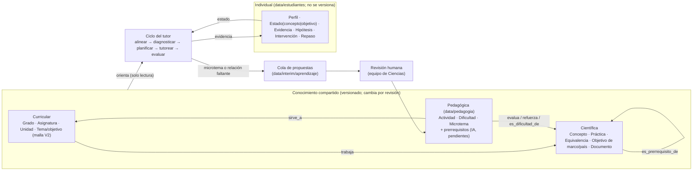

# 13 · Sistema de apoyo al aprendizaje sobre el grafo (diseño y prototipo)

> Estado (2026-10-11): **prototipo mínimo reproducible** en `src/goes_science_kg/aprendizaje/`, con tres recorridos
> de ejemplo en `aprendizaje/recorridos/`. El contenido pedagógico es **propuesta pendiente de revisión**. El
> funcionamiento técnico no demuestra una mejora del aprendizaje: eso exige un piloto con estudiantes (sección 9).

## 1. Propósito y frontera
Un sistema que el estudiante usa directamente para **complementar** la malla del MINED: identifica el objetivo que
está trabajando, revisa las bases que necesita, detecta dificultades con preguntas breves, refuerza lo justo, vuelve a
evaluar con otra actividad, actualiza su estado, regresa al objetivo y programa repasos.

- **No modifica la malla.** Usa los temas de la V2 tal como están (id, indicador y evidencia de logro). Los huecos de
  secuencia que encuentra (una base que la malla enseña después) se atienden con una activación breve y se informan
  al docente. Proponer cambios de malla es tarea de las propuestas curriculares (spec 06), no del tutor.
- **No mezcla capas.** Lo que hace un estudiante solo cambia su perfil. El conocimiento compartido (grafo y capa
  pedagógica) cambia por revisión humana.

## 2. Diagnóstico del grafo actual (verificado el 2026-10-11, no el estado reportado)
| Aspecto | Estado real | Reutilizable para el tutor |
|---|---|---|
| Rama y pruebas | `refactor/calidad-codigo`; pruebas en verde (más que las 93 reportadas) | — |
| Malla | **V2** en el grafo principal: 1.307 temas de 2.° a 11.°, todos con indicador y evidencia de logro | Objetivo curricular = tema; su indicador y su evidencia dan el criterio de logro |
| Conceptos | 513 (101 primaria, 192 secundaria, 206 bachillerato, 14 sin nivel), con definición y sinónimos | Capa científica; definición para el contexto del tutor |
| Prerrequisitos | 822 aristas (454 alta, 361 media, 7 baja); **todas inferidas por IA, ninguna revisada por una persona**; 459 por lógica y 363 por lógica confirmada con el orden observado | Base del recorrido «¿qué necesita?», tratadas como propuesta pendiente |
| Tema → concepto | 6.306 aristas TRABAJA (principal/secundario, con confianza) | Un concepto aparece en varios grados con objetivos distintos |
| Marcos | 493 objetivos (TIMSS 2027, TIMSS Adv., PISA 2025, ACARA SS) con página | Fuentes citables del objetivo |
| Internacional | 9 países; 9.°–11.°: 9.040 objetivos y 510 conceptos en consenso; **2.°–8.°: 3.615 objetivos y 448 conceptos (construido hoy)** | Referencia comparativa (núcleo/especialización), nunca prerrequisito |
| Revisión pendiente | `internacional/revision_humana.csv` (1.210 filas) y `internacional/2_8/revision_humana.csv` (568); 5 correcciones de clase sin confirmar | Se muestran como pendientes; no se promueven a hechos |
| Pedagogía | No existía: sin banco de ítems, dificultades, recursos ni datos de estudiantes | Se crea como capa nueva (sección 3) |

Dos límites del grafo que el tutor debe respetar:
1. **«Se enseña antes» es frágil.** El primer tema de un concepto sale de etiquetas de IA con huecos. Ejemplo: el grafo
   ubica «conservación de la energía» en 10.°, pero la verificación de la spec 11 encontró la V2 trabajándola en 5.° y
   8.°. Por eso una base «no enseñada antes» solo dispara una activación breve, nunca la conclusión de un déficit.
2. **Ningún prerrequisito está revisado.** El tutor los usa para formular hipótesis, no para afirmar dependencias.

## 3. Capas y esquema mínimo


| Capa | Nodos | Dónde | Quién la cambia |
|---|---|---|---|
| Curricular | Grado, Asignatura, Tema (= objetivo: procedimental + indicador + evidencia) | `data/grafo/` | ingesta de la malla del MINED |
| Científica | Concepto (nivel, definición), Práctica, ObjetivoMarco, ObjetivoPais, Documento | `data/grafo/`, `data/grafo/internacional*/` | procesos de las fases 1–3 con revisión |
| Pedagógica | Actividad, Dificultad, Microtema; relaciones de prerrequisito | `data/pedagogia/` (+ PRERREQUISITO_DE) | subagente `redactor-actividades` → validación → revisión humana |
| Individual | Perfil, Estado, Evidencia, Hipótesis, Intervención, Repaso | `data/estudiantes/` (fuera de git) | las respuestas del estudiante |

**Un concepto en varios grados.** El concepto no lleva grado: el grado lo da el tema que lo trabaja (TRABAJA) y el
microtema que lo refuerza (`grados`). «Concentración» aparece como contenido en 3.° y como base de la ósmosis en 9.°;
su microtema para 9.° tiene otra profundidad y otro lenguaje que uno para 3.°. El estado se registra **por estudiante y
por concepto, y por estudiante y objetivo**.

**Esquemas** (validación en `aprendizaje/pedagogia.py` y `estudiante.py`):
- `Actividad {id ACT:…, rol: objetivo|sondeo|practica|comprobacion, objetivos: [TEMA…] (≥1), evalua: [CON|TEMA],
  habilidad: recordar|observar|explicar|interpretar_datos|razonar, formato: opcion_multiple|numerica, grados,
  enunciado, opciones, correcta, distractores {opción → DIF}, valor/tolerancia, retroalimentacion, duracion_min ≤ 15,
  estado: propuesta_pendiente|verificado, revisado_por, fuente}`.
- `Dificultad {id DIF:…, concepto, descripcion, senales, estado, fuente (null hasta la revisión), justificacion}`.
- `Microtema {id MT:…, concepto, grados, titulo, explicacion (≤ palabras del grado), ejemplo, practica, comprobacion,
  duracion_min ≤ 15, criterio, estado, fuentes}`.
- `Estado {id, p, previa, estado: sin_evidencia|en_progreso|brecha|logrado_provisional|dominado, evidencias}`;
  `Evidencia {id, fecha, actividad, objetivo, evalua, respuesta, correcta, dificultad}`; `Hipotesis {concepto, tipo:
  base|en_el_concepto, motivo, puntaje, estado: abierta|confirmada|descartada|sin_comprobar, evidencias}`;
  `Intervencion` (sección 5); `Repaso {objetivo, fecha, intervalo}`.

## 4. Bidireccionalidad
### A. Recorrido del grafo
| Relación (sentido guardado) | Inversa | Capa | Significado |
|---|---|---|---|
| es_prerrequisito_de | requiere | pedagógica | sin el origen no se construye el destino (IA, pendiente) |
| trabaja | es_trabajado_en | curricular | el tema enseña el concepto |
| evalua | es_evaluado_por | pedagógica | la actividad aporta evidencia del concepto u objetivo |
| sirve_a | se_apoya_en | pedagógica | la actividad se escribió para ese objetivo |
| refuerza | es_reforzado_por | pedagógica | el microtema trabaja el concepto para un grado |
| es_dificultad_de | tiene_dificultad | pedagógica | dificultad frecuente del concepto |
| detecta | es_detectada_por | pedagógica | un distractor delata la dificultad |
| equivale_a | equivale_a (**simétrica**) | científica | el mismo concepto en dos asignaturas |

**Decisión:** cada relación se guarda **una vez** y la inversa se consulta con un índice inverso de la misma arista
(`relaciones.Navegador`). Así «A es_prerrequisito_de B» y «B requiere A» no pueden contradecirse; una prueba lo
comprueba en las 822 aristas. Se materializaría una inversa solo si tuviera datos propios de un sentido (no ocurre).
Solo `equivale_a` es simétrica: ninguna otra relación se trata como simétrica.

- «¿Qué necesita comprender?» `gskg tutor bases <tema>`: desde el concepto principal del objetivo, `requiere` hasta
  profundidad 2, con confianza ≥ media. Cada base dice si la malla la enseña **antes** (orden real: grado, unidad y
  código del tema) y si la relación está revisada.
- «¿Dónde ayudará reforzar esto?» `gskg tutor apoya <concepto> --grado g`: `es_prerrequisito_de` hasta profundidad 2
  y `es_trabajado_en`, filtrado a g…g+2.

### B. Retroalimentación educativa
El grafo **orienta** (bases y actividades), la respuesta **aporta evidencia**, la evidencia **actualiza** el estado
(rastreo bayesiano simplificado con desliz y acierto al azar) y el estado **ajusta** la siguiente intervención.
Una respuesta incorrecta solo actualiza lo que la actividad evalúa y **abre hipótesis** sobre las bases:
- puntaje = (1 − P previa de la base) × peso de la confianza de la arista × peso del distractor (si la opción elegida
  delata una dificultad de esa base);
- se comprueban con **sondeos** en orden: primero las bases (si falta una, reforzar el objetivo no sirve), al final la
  dificultad en el concepto evaluado, el del objetivo o el de la base que se comprueba (salvo que el distractor la
  señale);
- confirmar exige **dos evidencias** y P < 0,35; un sondeo correcto con P ≥ 0,6 descarta; lo no comprobado queda
  «sin comprobar», nunca «brecha».

## 5. Refuerzo: tipos, registro, momentos y límites
**Tres operaciones distintas:**
1. **Recuperar** un concepto existente y ofrecer una actividad de la capa pedagógica (`es_reforzado_por`,
   `es_evaluado_por`).
2. **Inyectar contexto** al agente tutor (`contexto.paquete`): el objetivo con su indicador y evidencia, el concepto
   con su definición, las bases, las fuentes citadas (fila de la malla, objetivos de marco con página), la referencia
   internacional **como comparación** y la evidencia **de este estudiante**; con restricciones de lenguaje por grado,
   no revelar la respuesta y volver al objetivo.
3. **Proponer** un microtema o una relación nuevos: va a la cola de revisión, sin datos del estudiante. Nunca se
   escribe en la capa compartida desde una sesión.

**Cada refuerzo registra** (`Intervencion`): objetivo al que sirve, concepto o habilidad, evidencia o regla que lo
motivó, recurso (con su estado), fuentes, duración, criterio de comprensión, condición para volver, profundidad y
resultado.

| Momento | Cuándo | Regla |
|---|---|---|
| Previo | antes del objetivo | solo bases de profundidad 1 que **la malla** enseña después o en el mismo tema; a lo sumo 1; es una activación por la secuencia de la malla, no un déficit |
| Durante | hipótesis confirmada | microtema → práctica → comprobación (otra actividad); si falla, diagnóstico de profundidad +1; 2 intentos |
| Posterior | objetivo logrado | repaso espaciado (1, 3, 7, 14 y 30 días) con actividades distintas; un fallo vuelve al primer intervalo |

**Límites** (`config/aprendizaje.yaml`): profundidad 2; 3 refuerzos y 25 minutos de desvío por sesión; 15 minutos por
refuerzo; 3 sondeos por intento; 3 hipótesis abiertas. Al tocar un límite se vuelve al objetivo y se deja una nota al
docente. **Cierre:** el objetivo queda «logrado provisional» cuando la reevaluación con otra actividad es correcta;
pasa a «dominado» con el repaso.

**La frecuencia internacional no decide.** Que 8 países enseñen un concepto en el núcleo es una referencia
comparativa en el contexto del tutor y en el informe al docente. No crea prerrequisitos ni agrega contenido.

## 6. Funciones agénticas
| Función | Entradas | Decisiones | Herramientas | Salidas | Implementación |
|---|---|---|---|---|---|
| Alineación curricular | texto del estudiante o tarea del docente, grado | qué tema de la malla; si es ambiguo, preguntar | GraphRAG del proyecto, malla | objetivo + candidatos + decisión | determinista (`contexto.alinear`); un LLM solo para desambiguar en diálogo |
| Diagnóstico | evidencia, estado, bases | qué hipótesis abrir, qué sondear, cuándo confirmar | navegador, capa pedagógica, estado | hipótesis con estado | **determinista** (`diagnostico.py`): auditable, sin que un LLM decida el dominio |
| Planificación del refuerzo | hipótesis confirmada, objetivo, grado, presupuesto | qué microtema, en qué momento, si cabe en los límites | capa pedagógica, límites | `Intervencion` o nota/propuesta | determinista (`planificador.py`) |
| Tutoría | intervención + paquete de contexto | cómo explicar, qué andamiaje, cómo pedir la respuesta | contexto inyectado; LLM | diálogo; respuesta del estudiante | **agente LLM** con herramientas de solo lectura (pendiente de construir; el prototipo usa el texto del microtema) |
| Evaluación | respuesta, actividad | correcta o no; qué dificultad delata | clave, distractores; rúbrica para abiertas | evidencia | determinista para opción múltiple y numérica; LLM evaluador **separado del tutor** para respuestas abiertas, con revisión docente si la confianza es baja (pendiente) |

**Por qué así:** un solo agente conversacional (tutoría) da coherencia y baja latencia al diálogo; el diagnóstico, la
planificación y el estado son servicios deterministas que ese agente llama como herramientas, para que el estado del
estudiante sea reproducible y auditable y no dependa de un LLM. El evaluador de respuestas abiertas va aparte del tutor
para que nadie califique su propia explicación. La generación de contenido es **fuera de línea**: el subagente
`redactor-actividades` llena lotes que se validan (`gskg lotes validar`) y se revisan antes de usarse.

## 7. Cobertura y adaptación
- **Piloto: 9.°–11.°**, donde hay más evidencia (contraste internacional verificado, malla V2 completa). Los tres
  recorridos son de 9.°.
- **Extensión a 2.°–8.°:** ya existen la malla V2, los conceptos, los prerrequisitos (IA) y desde hoy el contraste
  internacional 2.°–8.°. **Falta**: actividades, dificultades y microtemas para primaria (el prototipo no los inventa),
  calibrar el lenguaje con docentes de primaria, formatos no textuales (imágenes, manipulación, lectura en voz alta)
  y la revisión de las relaciones de prerrequisito en primaria. La alineación curricular de 2.°–8.° es la de la malla y
  su clasificación TIMSS/PISA; no se agrega ninguna.
- **Adaptación** (`config/aprendizaje.yaml`, `adaptacion`): palabras y registro por tramo (40 palabras y lo concreto
  en 2.°–4.°; 100 y lo formal en 10.°–11.°). Las habilidades incluyen observar, explicar, interpretar datos y
  razonar, además de recordar; `obj-1` y `obj-2` de cada objetivo usan habilidades distintas.

## 8. Prototipo
```bash
uv run gskg tutor bases G09-CIE-U2-2.4                  # «¿qué necesita?»
uv run gskg tutor apoya CON:quimica/constante-de-equilibrio --grado 9   # «¿dónde ayudará?»
uv run gskg tutor alinear "no entiendo por qué la papa pierde peso en agua con sal" --grado 9
uv run gskg tutor contexto G09-CIE-U8-8.2 --grado 9     # lo que se inyecta al tutor
uv run gskg tutor preparar-actividades <tema>…          # lotes → subagente redactor-actividades
uv run gskg tutor unir-actividades                      # valida y agrega (nace «propuesta_pendiente»)
uv run gskg tutor validar                               # capa pedagógica e inversas
uv run gskg tutor recorridos                            # los tres recorridos → aprendizaje/recorridos/
```
Pruebas: `tests/test_aprendizaje.py` (inversas, bases, hipótesis, límites, reevaluación con otra actividad, vínculo
con objetivos, aislamiento de las capas compartidas y determinismo).

## 9. Qué está comprobado y qué sigue siendo hipótesis
- **Comprobado técnicamente:** las relaciones inversas son coherentes; cada intervención está vinculada a un
  objetivo; la evidencia de un estudiante no modifica `data/grafo/` ni `data/pedagogia/` (huella sha256 antes y
  después); los límites se respetan; los recorridos son deterministas.
- **Hipótesis de diseño:** los parámetros (previas, desliz, umbrales, límites, intervalos de repaso), el orden de las
  hipótesis y la duración de los refuerzos. Se calibran con datos de un piloto.
- **Propuesta pendiente:** todo el contenido pedagógico y todas las relaciones de prerrequisito.
- **No demostrado:** que el sistema mejore el aprendizaje. Requiere un piloto con estudiantes (grupo de comparación,
  pre/post sobre los objetivos, tiempo en tarea, opinión docente) y la aprobación del MINED.

## 10. Datos faltantes y decisiones pendientes
**Datos:** banco de actividades revisado (hoy 3 objetivos, todo pendiente); dificultades con fuente (literatura de
didáctica o diagnóstico docente); revisión humana de los prerrequisitos (0 de 822); evaluador de respuestas abiertas
con rúbrica; contenido para primaria; recursos multimedia; datos de un piloto para calibrar; huecos de etiquetado de
temas (p. ej. conservación de la energía en 5.° y 8.°).

**Decisiones del MINED/GOES:** quién revisa y aprueba la capa pedagógica y con qué criterio; política de datos de
estudiantes (consentimiento, menores de edad, retención, anonimización); si el tutor se usa en clase o fuera; qué
modelo LLM y dónde se aloja; cómo se informa al docente; qué grados y asignaturas entran al piloto; y si los huecos de
secuencia que el tutor detecta se llevan a la revisión de la malla.
