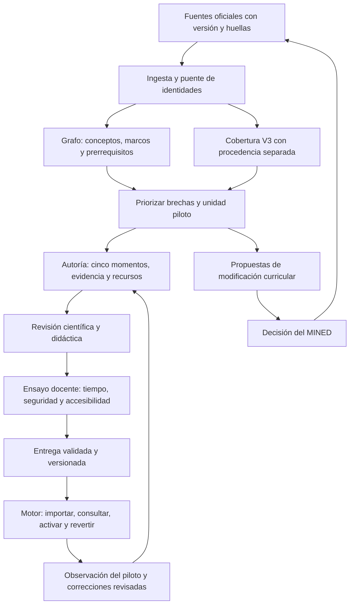

# 16 · Contenido estructurado y entrega al motor

## Objetivo y autoridad

Convertir las mallas salvadoreñas de Ciencias de 2.°–11.° en contenido trazable que permita diseñar,
revisar y consumir secuencias de aprendizaje. El grafo fundamenta las decisiones curriculares y los
prerrequisitos; los componentes pedagógicos aportan material para autoría. La entrega inicial es
**GOES Science Content v0.1.0**, contrato **1.0.0**, con corte 2026-10-15.

La V3 del MINED es la fuente curricular vigente. Las inferencias del panel IA son dictámenes interinos;
solo una persona competente puede verificar contenido para aula y el MINED decide las modificaciones
institucionales de la malla. El motor debe conservar ambas distinciones. Las decisiones humanas existentes
no se sustituyen ni se vuelven a clasificar. Esta especificación amplía el alcance inicial de la spec 00
conforme a las specs 13–15 y la prioridad del responsable: contenido estructurado para cargar al motor.

## Antecedentes que orientan el diseño

Estos proyectos documentan partes del proceso, sin demostrar que este contenido salvadoreño sea válido:

| Referencia primaria | Aporte al diseño | Límite de la comparación |
|---|---|---|
| [Learning Commons, Curriculum Alignment](https://learningcommons.org/resources/curriculum-alignment/) | Separar estándares, componentes y progresiones enlazados por grafo | Sus componentes y progresiones granulares se concentran en Matemática; no equivale a nuestra cobertura completa de Ciencias |
| [Oak, descarga curricular](https://open-api.thenational.academy/bulk-download) y [Aila](https://support.thenational.academy/using-aila) | Contenido estructurado y curado, adaptable por docentes | La disponibilidad de una API no reemplaza revisión local ni autoriza copiar sus materiales |
| [Shiksha Copilot, estudio](https://arxiv.org/html/2507.00456v3) | Curación previa y posterior personalización docente; estudio con 1.043 docentes y 23 curadores | El estudio no midió efectos en aprendizaje de estudiantes |
| [OpenSALT](https://opensalt.net/about) y [CASE](https://www.1edtech.org/standards/case) | Identificadores y asociaciones interoperables entre marcos | Este contrato no declara conformidad ni certificación CASE; el mapeo queda pendiente |
| [OpenSciEd, modelo didáctico](https://openscied.org/why-openscied/instructional-model/) | Diseñar unidades coherentes y revisar evidencia de aprendizaje | Se conserva la secuencia local aprobada de cinco momentos; no se adopta otra secuencia automáticamente |

## Flujo unificado



El primer hito permite exportar los componentes actuales para **consulta y autoría asistida** antes del ensayo
docente. Ese acceso no salta las revisiones G–H ni habilita el uso en aula. Los ciclos técnicos comprueban datos,
invariantes y comportamiento del consumidor; no demuestran eficacia educativa.

## Qué marcos se usan

| Tramo | Referencia de análisis | Regla |
|---|---|---|
| 2.°–4.° | TIMSS 2027, 4.° | Progresión hacia el referente; no se exige cada objetivo en cada grado |
| 5.°–6.° | TIMSS 2027, 8.° | Preparación hacia 8.°, con aplicabilidad por tramo |
| 7.°–8.° | TIMSS 2027, 8.°, y PISA 2025 | Análisis separados; escenarios de decisión 100/0, 0/100 y 50/50 en el análisis de cobertura; no equivalencia de escalas |
| 9.° | PISA 2025 | Conocimientos de contenido, procedimental y epistémico, subcompetencias, contextos y demanda |
| Física 10.°–11.° | TIMSS Advanced 2015 | Su población y propósito son distintos de PISA y TIMSS básico |
| Biología y Química 10.°–11.° | ACARA Senior Secondary | Complemento de contenidos explícitamente identificado, acordado con el responsable |

TIMSS 2023 queda como referencia histórica. Los pesos de puntos de evaluación de PISA son referencias de balance,
no porcentajes obligatorios de clases. La clasificación del análisis V3 se exporta en `analisis.jsonl`; las relaciones
`CUBRE` previas siguen en el grafo con su procedencia. El exportador no elige automáticamente entre discrepancias.

## Contrato y estructura de la entrega

`config/motor.yaml` fija versión, corte, directorios y perfiles. Pydantic en `motor/contrato.py` es el contrato
ejecutable; `esquemas.json` distribuye sus JSON Schema. No se necesitan Neo4j ni un servidor para consumirlo.

| Archivo | Contenido y garantía |
|---|---|
| `manifiesto.json` | Versión del contrato y contenido, corte explícito, commit base, SHA de insumos, SHA/tamaño/conteo de archivos, métricas, advertencias e id de entrega |
| `temas.jsonl` | Catálogo completo V3: id estable, alias del análisis, grado y asignatura actuales, alcance, orden real y todas las columnas normalizadas de la fuente |
| `puente.jsonl` | Correspondencia exacta 1:1 por archivo, hoja, fila, rango, grado, procedimental y SHA de columnas; también SHA del libro |
| `nodos.jsonl`, `relaciones.jsonl` | Proyección del grafo principal completo, con fuentes, confianza y relaciones identificadas por contenido de su clave |
| `analisis.jsonl`, `catalogos.json` | Clasificaciones V3 y catálogos de TIMSS/PISA/ACARA, separados del grafo heredado |
| `componentes.jsonl` | Registros pedagógicos completos, dependencias, revisión y permisos calculados por componente |
| `paquetes.jsonl` | 230 agrupaciones existentes, con referencias a componentes, conceptos, bases, fuentes y diagnósticos de origen |
| `referencias.jsonl` | Valores localizados en documento con SHA, página o localizador, unidad y condiciones; vacío en esta entrega inicial |
| `esquemas.json`, `LEEME.md` | Contrato consumible y orientación sobre el uso de la entrega |

Los alias `NM26-*` del análisis no se convierten por sustitución de prefijos: se cruzan con la fila oficial.
El id estable puede conservar un número de unidad histórico. `orden` es una secuencia global según libros,
hojas y filas oficiales; no es una recomendación didáctica. Las columnas completas conservan bloques combinados.
La extracción previa del grafo se mantiene aparte y se declaran nueve temas con diferencias de extracción.
No se corrige silenciosamente la clasificación de esos temas ni se modifica el grafo original.

El insumo independiente se incorpora selectivamente en `data/interim/motor/analisis_v3/`: identidades compactas,
clasificaciones, catálogos y procedencia con SHA originales. La compilación posterior solo requiere estos archivos,
las fuentes canónicas y las capas versionadas; no requiere las carpetas locales `analisis_nuevas_mallas/` ni
`nuevas_mallas/`. Dos reemplazos elegidos por el responsable se conservan como selección de paquete,
no como alias de equivalencia curricular.

## Calidad y permisos

| Perfil | Qué permite | Qué verifica |
|---|---|---|
| `consulta` | Examinar catálogo, fuentes, clasificaciones y todos los componentes seleccionados | Expone el estado y los límites originales; no presenta propuestas como decisiones |
| `autoria` | Trabajar con componentes con revisión favorable del panel | Excluye pendientes, frágiles, descartes y dependencias bloqueadas; excluye propuestas GOES salvo opción explícita |
| `aula` | No habilitado en contrato 1.0.0 | Todos los registros exigen `aula=false`; ni una opción del importador puede promoverlos |

Las huellas detectan alteraciones de bytes; no autentican la identidad ni la autoridad institucional de quien
produjo una entrega. El validador recalcula permisos y dependencias, comprueba el grafo y los códigos y rechaza
concesiones incompatibles con los estados declarados. La confianza del distribuidor y la futura firma institucional
son un trabajo separado. El estado de panel se conserva como metadato del productor, no como firma humana.

El detector de «tabla de referencia» solo señala dependencias probables. Ausencia de marca significa
`no_evaluado`, nunca `no_requiere`. Los datos citables faltantes no se rellenan por estimación y los diagnósticos
antiguos de completitud del paquete no se convierten en permisos. Los seis casos pedagógicos sin consenso
siguen bloqueados; una nota de esterificación frágil permanece consultable y excluida de autoría.

Una actividad con `duracion_min=15` no demuestra que un paquete sea ejecutable en 55 minutos: las actividades
pueden ser alternativas o refuerzos. La fila propuesta de espectros de masas/infrarrojo sigue costando una sesión
adicional de 55 minutos sin compensación demostrada. Las notas no presuponen coste cero.

## Exportar, importar y reproducir

```bash
uv run gskg motor exportar --version 0.1.0
uv run gskg motor validar entregas/motor/0.1.0
uv run gskg motor importar entregas/motor/0.1.0 --almacen /tmp/goes-motor
uv run gskg motor consultar G10-FIS-U7-7.5 --perfil autoria --almacen /tmp/goes-motor
uv run gskg motor activar <id-entrega-anterior> --almacen /tmp/goes-motor
```

El consumidor de referencia importa por SHA de entrega a una carpeta inmutable. Repetir una importación no
duplica registros. Valida antes y después de copiar, publica por renombrado y activa mediante sustitución atómica
de `activo.json`. Revertir activa una entrega anterior validada; no borra la historia. Una entrega corrupta o una
activación fallida dejan intacto el puntero anterior. Un tema sin paquete sigue siendo consultable: tener 935 temas
de catálogo no equivale a tener 935 clases. Para autoría se declaran los componentes omitidos y sus motivos.

El validador requiere únicamente la carpeta entregada y este paquete Python instalado; no lee las fuentes del
productor. El consumidor también puede funcionar sin ese repositorio si recibe `--almacen` explícito.
No hay integración con un motor de producción ni API de escritura de terceros en este hito.

Para reproducir bytes, usar los mismos insumos, configuración, código y dependencias y el `commit_base` registrado:

```bash
uv run gskg motor exportar --version 0.1.0 --destino /tmp/reproduccion --commit-base <sha-base-del-manifiesto>
```

El valor por defecto de `commit_base` es HEAD al exportar; las huellas del código y datos capturan el contenido
real incluso si está por confirmar en git. No se usan horas del sistema, rutas temporales ni ids aleatorios en los
archivos publicados. Un destino existente con otra entrega se rechaza. Cambios del contrato incompatibles requieren
nueva versión de contrato; cambios de contenido o procedencia, una entrega nueva con otro id.

## Ruta después de la entrega técnica

**Actualización autorizada por el responsable (2026-10-15):** al no disponer de revisión humana se continúa esta
fase con expertos IA, psicopedagogía y refutación, extendiendo la autoría a todos los grados (spec17). Esa decisión
reemplaza la prioridad anterior de limitar la autoría a una unidad antes de extenderla. No se registran firmas
humanas ni tiempos observados; la entrega0.1.0 permanece como corte histórico reproducible.

1. **Cerrar una unidad piloto para autoría.** Candidata: Física 10.°, «4. Trabajo, energía y momento», cuatro temas
   (`G10-FIS-U7-7.5`, `G10-FIS-U7-7.7`, `G10-FIS-U7-7.9`, `G10-FIS-U8-8.1`). Confirmar sus prerrequisitos,
   localizar los datos científicos y resolver discrepancias de fuentes antes de redactar.
2. **Desarrollar la secuencia local.** Aproximar, Explorar, Explicar, Indagar y Reforzar, con evidencia observable,
   instrumento de evaluación y retroalimentación. Documentar qué actividades ejercitan habilidades del siglo XXI,
   DigComp y las competencias de Ciencias; esas etiquetas necesitan evidencia en la actividad. No presumir
   cobertura por escribirlas en una columna. La versión y alcance exactos de DigComp deben verificarse al curar.
3. **Revisión científica y didáctica.** Revisor de disciplina comprueba afirmaciones, valores, fuentes y seguridad;
   revisor didáctico comprueba demanda, subcompetencias, evidencias y accesibilidad. Registrar discrepancias y cambios,
   repetir las comprobaciones y conservar lo no resuelto.
4. **Ensayo docente de sesiones de 55 minutos.** Diseñar presupuesto explícito por momento, preparación,
   transiciones y evaluación; registrar tiempo observado y ajustes. La secuencia puede necesitar más de una sesión:
   el presupuesto se demuestra, no se fuerza sumando una lista arbitraria.
5. **Piloto e integración real.** Acordar interfaz con el equipo del motor, responsables de publicación y revisión,
   política de datos y criterios del piloto. Aprobar contenido por personas identificadas y un mecanismo de permisos
   de aula en una nueva versión del contrato. Medir uso, fidelidad y dificultades; evaluar aprendizaje con un diseño
   adecuado antes de afirmar mejoras. Extender a otras unidades solo tras revisar el piloto.

La prioridad inmediata sigue siendo la unidad piloto y sus fuentes, no ampliar automáticamente el catálogo
pedagógico a los 935 temas. Los Excel anotados de la spec 15, las decisiones institucionales del MINED y el cierre
de los seis casos humanos continúan como frentes explícitos, sin marcarse completados por esta exportación.
