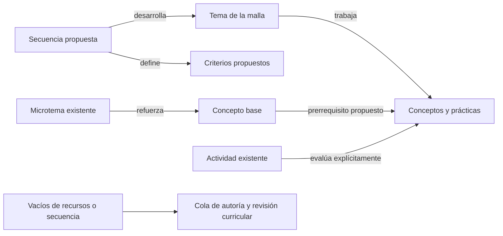

# 18 · Grafo de conocimiento para reforzamiento en todos los grados

## Objetivo confirmado por el responsable

El responsable reiteró el 2026-10-15 que el producto central son los grafos de conocimiento de todos los
grados, para apoyar clases, identificar vacíos y proponer una mejor progresión. La revisión de las secuencias
de la spec 17 es un insumo. Un catálogo de clases o un Excel no completa esta integración.

Se conectan, para los 920 temas de Ciencias de 2.º–11.º:

El diagrama expresa las clases de relación. No afirma que existan actividades y microtemas suficientes para
todos los temas. Un criterio textual no se enlaza automáticamente a todos los conceptos del tema.

## Qué demuestra la auditoría

El grafo curricular ya cubre todos los grados. Sus diez diagnósticos se reproducen; no hace falta inventar otro
catálogo de conceptos. Las carencias están en la conexión pedagógica y en el contenido utilizable:

- 920 secuencias con `tema_id`, pero 2.760 criterios sin identificación ni mapeo semántico explícito.
- Seis temas metodológicos de 10.º tienen prácticas y carecen de concepto principal. Esto es legítimo;
  no deben rellenarse artificialmente para satisfacer una función que solo recorre conceptos.
- En el banco del repositorio no hay sondeos ni microtemas para 2.º, 4.º, 6.º y 8.º. El banco del repositorio,
  lo exportado al motor y lo permitido para autoría son conjuntos diferentes.
- 822 prerrequisitos inferidos; la ausencia de firma humana no se transforma en firma de un agente.
- 152 apariciones de prerrequisitos ausentes o posteriores por grado corresponden a 112 relaciones distintas.
  No son 152 vacíos de aprendizaje comprobados.
- Hay casos de etiquetado discutible: propagación asexual en sexto no exige por sí misma ingeniería genética.
  Antes de proponer anticipar un contenido hay que revisar el camino y su evidencia.

Evidencia: `data/interim/grafo_refuerzo/auditoria_estructura.json` y `auditoria_rutas.json`.
El diagnóstico individual del tutor, sus probabilidades y sus limitaciones se mantienen separados de esta proyección.

## Integración sobre fuentes versionadas

Se genera una proyección compuesta desde la entrega validada `entregas/motor/0.2.0/`. El grafo curricular
permanece como fuente de verdad; las secuencias y componentes pedagógicos mantienen sus fuentes y permisos.
La proyección une esas capas sin reescribir `data/grafo/` ni sustituir las entregas existentes.

Cada nodo y relación añadidos se pueden explicar por un campo explícito de la entrega. Se conservan los nodos
y aristas originales con sus atributos. Las nuevas relaciones conectan secuencia con tema, secuencia con
criterios y recursos con sus objetivos, conceptos o dependencias declarados. Definir un criterio no demuestra
que haya una evaluación válida para ese concepto. Los mapeos faltantes permanecen pendientes.

Cada ruta por tema muestra:

- Identidad y alias exactos, grado actual y fuente; secuencia y retenciones.
- Conceptos y prácticas con rol y confianza; bases y relaciones que explican el recorrido.
- Antecedentes según grado y orden de la fuente. Dos archivos distintos del mismo grado no se ordenan por id.
- Actividades y refuerzos realmente disponibles, grado compatible y permisos de cada recurso.
- Disponibilidad de diagnóstico y reevaluación con actividades diferentes; abiertas y cerradas se distinguen.
- Recursos o mapeos que faltan, sin simular una respuesta o un dominio del estudiante.

No se reutiliza automáticamente un microtema de grado inferior como si estuviera adaptado al grado actual.
La proyección conserva el contenido para consulta y registra cuándo hace falta una adaptación.

## Vacíos y nueva dirección curricular

La cola distingue necesidades de contenido, de mapeo y de revisión de la progresión. Una base ausente o
posterior es una señal para investigar, no una orden de insertar temas. La prioridad puede usar el número de
temas distintos afectados por un concepto; ese impacto estructural no demuestra ganancia de aprendizaje,
ahorro de horas ni eficacia de una intervención.

La siguiente autoría debe convertir las necesidades priorizadas en microtemas, sondeos y comprobaciones
específicos por grado, con revisión disciplinar, psicopedagógica y adversarial. Para cambiar relaciones
conceptuales discutidas se conservan la evidencia previa y la nueva decisión. Los marcos internacionales
siguen como pivote; la presencia en otro país no crea por sí misma un prerrequisito.

## Aceptación

- Cobertura exacta de los 920 temas, incluidas rutas con recursos pendientes y temas de prácticas.
- Conservación del grafo y las entregas fuente; nodos y extremos válidos, sin duplicados ni mapeos inventados.
- Consulta por id o alias y navegación entre tema, bases, recursos y criterios.
- Permisos y carencias visibles; sin datos personales ni dominio supuesto, aula deshabilitada.
- Exportación determinista, huellas verificables e inmutabilidad de la versión publicada.
- Visor por grado y disciplina, con relaciones legibles y una cola accionable de mejora.

Esta fase prepara el soporte compartido del refuerzo y la autoría. No declara que el tutor anterior ya pueda
ejecutar todas las rutas: la auditoría identifica fallos de disponibilidad y de transición que requieren su propia
corrección y pruebas. Tampoco certifica aprendizaje ni sesiones de 55 minutos observadas.
